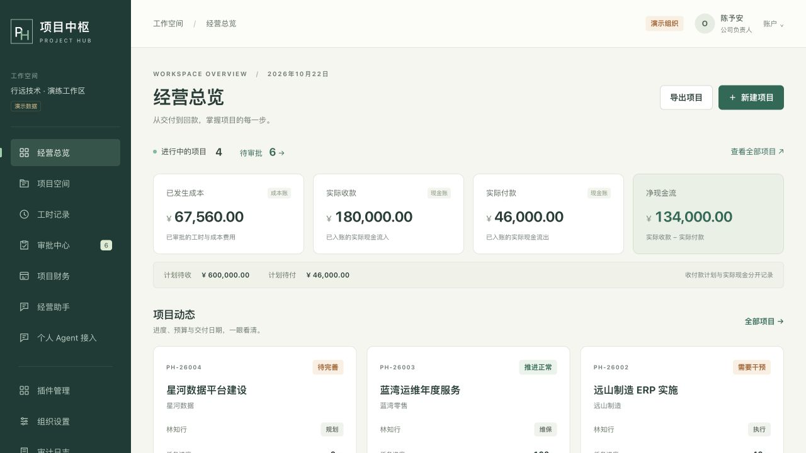

# 项目中枢 · Project Hub

面向100人以下软件开发、实施与技术服务公司的自托管项目经营系统。**1.0 产品范围为小微企业简化版：以项目为中心，只回答项目收益与现金流**（见 [产品范围](docs/product-scope.md)）；面向没有财务软件和OA的小团队，所有核心业务都应有内置入口。

[](https://github.com/lakii2982/project-hub/actions/workflows/test.yml)
[Apache-2.0](LICENSE) · [迭代路线](ROADMAP.md) · [当前能力与差距](docs/delivery-status.md) · [参与开发](CONTRIBUTING.md)

当前已发布 **0.1.0 工程验证版**。2026-11-03 起 1.0 范围重定义为小微企业简化版（项目收益 + 现金流）：合同版本、收入确认、结算核销、银行现金、预算/ETC、四类核对、关期、多币种、工资与导入等专业能力移出当前 1.0，代码、数据与审计保留、默认隐藏/停用（见 [产品范围](docs/product-scope.md) 与 [DECISIONS](project/DECISIONS.md)）。当前能力、可用入口及浏览器/部署验收缺口统一见 [交付现状](project/STATUS.md)，不以任务或 PR 数量表示产品完成度。



## 长期开发与换Agent接续

仓库事实优先于聊天记录。所有coding agent共用 [AGENTS.md](AGENTS.md)、[项目manifest](project/manifest.json)、[任务契约](project/tasks.json)、Git和CI。Claude、Gemini、Copilot、Cursor入口只指回同一份规则；不假定所有工具都会自动加载它们。

给任意新coding agent的起始指令：

> 阅读AGENTS.md、project/manifest.json、其中的active_handoff与docs/delivery-status.md。核对Git分支和脏修改，运行projectctl check/next，选择依赖满足的ready任务并读其brief/spec。按仓库流程完成一个薄片、独立评审、实际验收、PR和交接；保留别人的修改，不把目标写成已实现。普通技术选择自行处理，只有业务口径无法判断时询问我。

```sh
python scripts/projectctl.py check
python scripts/projectctl.py next
python scripts/projectctl.py brief PH-001
```

CLI只读，不执行元数据中的命令、不改Git状态、不调用模型。`orient.delivery_flow` 提供有界主线统计与在制工作提示，规则见 [按可用成果推进](docs/engineering/agent-protocol.md#9-按可用成果推进2026-11-01-起生效)；目录变化只是提示，不证明可用成果。实现PR从BASE取任务范围和检查器；扩大范围先做规划PR。详细流程、版本、失败恢复和信任边界见 [工程规范](docs/engineering/README.md)。仓库不要求某个模型供应商、付费API或个人Codex配置。

## 本机运行（一条命令演示）

需要Python 3.12+，并让python3指向该版本；也可用PMO_PYTHON指定Python可执行文件。先安装一次依赖：

```sh
git clone https://github.com/lakii2982/project-hub.git
cd project-hub
sh scripts/local.sh
python scripts/demo.py --slice micro
```

`scripts/demo.py --slice micro` 会建立独立的 `runtime/demo.sqlite3` 演练库、写入虚构演练数据、在后台启动本地服务并退出 0，同时打印可访问地址、演练账号与 5 步演示脚本。若该文件已存在，必须是本命令此前建立的演练库（公司均为演练数据、迁移齐全）才复用且**不迁移、不写入**；0 字节/空 SQLite/非项目库/真实公司库/旧结构演练库一律拒绝。重复执行幂等：不会重复造数、不会写入已有数据库，并复用已运行的服务。停止服务器用 `python scripts/demo.py --stop --db <启动时的库> --port <启动时的端口>`。

先进入项目目录再运行相对路径命令。浏览器打开打印的 <http://127.0.0.1:8765/>；命令打印六类演练账号（owner/finance/pm/member/auditor/newbie），随机密码不打印到控制台，只写入本机 `runtime/demo-credentials.txt`（0600），不进入Git和源码包。演示数据均为虚构，不含真实客户、工资或凭据；不能初始化到生产环境，也不要用演练库承接真实业务。

演练结束后切到正式库：先停止演练服务，再用只读检查确认可以切换，然后执行切换（默认目标是本机正式库 `runtime/pmo.sqlite3`）：

```sh
python scripts/demo.py --stop --db <启动时的演练库> --port <启动时的端口>
python scripts/go-live.py --check
python scripts/go-live.py
```

`scripts/go-live.py` 在演练服务仍在运行、目标库已有公司、或目标库就是演练库时拒绝（退出码 2/3）且不写任何数据库；只有空/不存在的目标库才会 `migrate --noinput`，随后校验正式库没有演练组织（`is_demo=1` 为 0）并打印 `http://127.0.0.1:8000/setup/` 首次启用入口；空库重复执行幂等。它不会删除或覆盖演练库，不写入演练数据，不启动长期服务，输出不含密码/密钥。生产部署仍用 `scripts/install.sh --domain <域名>`，安装后打开 `https://<域名>/setup/`。

真实公司使用独立数据库，跳过seed_demo，运行：

```sh
.venv/bin/python manage.py bootstrap --company "你的公司" --username owner
```

密码交互输入。当前基础数据存于 `runtime/pmo.sqlite3`，附件在 `runtime/uploads/`；正式部署使用PostgreSQL与独立持久卷。备份必须同时覆盖数据库与附件，见 [运维手册](docs/operations.md)。owner/finance/auditor 登录后可在导航打开 `/status/`，只读查看版本、数据库连通/待迁移、最近备份与附件计数，不显示密钥或主机路径。

本轮代码已合入项目详情六页签、成本预算余额图、关键任务关联与项目级工时；基础资料共用 Project/Employee/CostRate 服务。全站体验与经营趋势仍有 PH-026 等未完成范围，不能将视觉样张当作这些页面已交付。最新验证见 [交付状态](docs/delivery-status.md)，本机使用步骤见 [测试环境](docs/local-testing.md)。

## 当前业务能力

> 下表描述 `main` 上**代码层面已存在**的能力（含专业财务实现）。其中合同版本、收入确认、结算核销、银行现金、预算/ETC、核对/关期、多币种、工资、导入与 Agent 接入已移出小微版 1.0 用户承诺，默认隐藏/停用；1.0 保留与简化清单见 [产品范围](docs/product-scope.md) §5–6。

| 入口 | 已有能力 |
| --- | --- |
| 项目空间 | 三类项目模板、阶段门禁、里程碑/收付款计划关联的关键任务、风险、验收和归档；详情六页签与历史任务区 |
| 工时与成本 | 按项目登记工时、生效日费率快照、独立审批、费用成本与冲销；当前批准预算减累计确认成本的余额图 |
| 项目现金 | 实际收付、现金计划、部分核销、13周计划测算、逾期单列 |
| 审批与审计 | 自审阻止、锁账、不可变账本、附件、来源与审计哈希链 |
| 内置输入 | 浏览器表单、CSV预览/原子提交/幂等/安全导出 |
| 个人Agent接入 | 本人身份、项目与操作范围、期限/撤销；7个MCP工具 |
| 插件管理 | 按公司启停、依赖与版本检查、Outbox和重试；新增业务插件见当前交付现状 |

金额持久化整数分，工时整数分钟，核算用Decimal。成本和现金独立记账；现金计划不是完整应收应付，净现金流不是利润，当前任务数量完成率也不是合同履约进度。图中计划线仅作参考，实际成本包含负值冲销；使用当前批准预算重述历史，不能视为历史预算版本。老板决策工作台是后续产品任务。

## 双层AI的实现边界

当前核算和提醒主要由规则引擎执行。可选模型提取候选单据字段，但需要服务器配置后才能使用；个人MCP通道已完成协议与本地HTTP预校验，真实WorkBuddy/Codex客户端仍待联调。

目标是个人AI降低录入负担，系统AI解释经营问题并推动办理；模型不能直接审批、支付或改账。个人令牌最小授权，默认dry_run，真实填报进入原业务审批。配置说明见 [MCP接入](integrations/mcp/README.md)。启用云模型后，选定资料会发给对应服务；自托管不等于AI数据不出网。

## 公司服务器部署

已提供PostgreSQL、应用、事件worker、Caddy四服务编排。服务器安装一条命令：`scripts/install.sh --domain pmo.example.com`（首次生成 0600 `.env` 与随机密钥，绝不覆盖已有 `.env`/卷；失败保留现场并可重试）。安装后浏览器走 `/setup/` 首次启用，登录后 `/status/` 只读查看健康与最近备份；备份与隔离恢复见[本地备份](docs/local-backup.md)和[运维手册](docs/operations.md)。真实 Compose/PostgreSQL 部署与 TLS 仍需在目标环境执行并留证；非技术用户的一键安装与首次启用向导属 0.2 目标。

```sh
cp .env.example .env
# 填域名、独立随机应用密钥和数据库密码，配置DNS。
docker compose up -d --build
docker compose exec app python manage.py bootstrap --company "你的公司" --username owner
```

只有代理暴露80/443，数据库和应用使用内部网络。生产配置拒绝默认密钥、弱数据库密码、SQLite和DEBUG。

## 验证、发布与维护

```sh
.venv/bin/python manage.py check
.venv/bin/python manage.py makemigrations --check --dry-run
.venv/bin/python manage.py test tests --verbosity 1
.agent-venv/bin/python -m unittest discover -s integrations/mcp -p 'test*.py'
.venv/bin/python scripts/package.py
.venv/bin/python scripts/verify-source-package.py releases/project-hub-0.1.0-source.zip
```

最后一条中的版本与pyproject.toml一致；发行workflow自动读取版本。CI包括任务治理、SQLite/PG回归、MCP握手、公开内容/秘密扫描、容器与隔离数据库恢复；另有CodeQL。配置存在不等于某次检查已通过，请查看对应提交的Actions记录。依赖由Dependabot提出PR，全部经过任务、评审和检查，不自动合并。

发布按 [发布规范](docs/engineering/releases.md) 与当前工作流显式执行；标签、构建、草稿和公开发布分别核对，合入 main 不等于发布；0.x标为pre-release。1.0有单独就绪门槛。版本与异常分支见 [发布规范](docs/engineering/releases.md) 和 [恢复矩阵](docs/engineering/recovery.md)。

## 设计、贡献与安全

- [业务需求](docs/product-requirements.md)、[财务规则与反例](docs/accounting-rules.md)
- [系统架构](docs/architecture.md)、[业务插件演进](docs/plugin-evolution.md)
- [当前交付状态](docs/delivery-status.md)、[验证记录](docs/verification.md)
- [贡献规范](CONTRIBUTING.md)、[安全报告](SECURITY.md)
- [开源方案评估](docs/open-source-review.md)、[第三方来源与许可](THIRD_PARTY_NOTICES.md)

复用Django、DRF、django-axes、WhiteNoise、pluggy及官方MCP SDK等成熟组件。没有复制ERPNext、OpenProject、Odoo、Plane、Jira或DeepSeek Harness业务源码。自有源码采用Apache-2.0，依赖保留各自许可。
