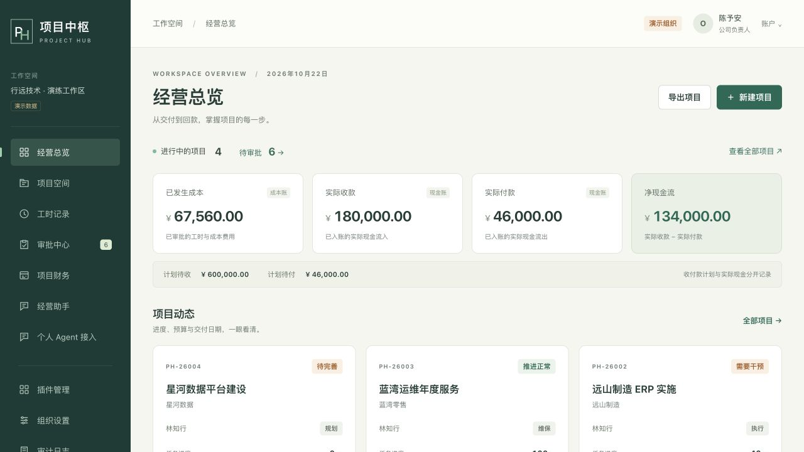

# 项目中枢 · Project Hub

面向100人以下软件开发、实施与技术服务公司的自托管项目经营系统。以项目连接交付、工时、成本、结算与现金；面向没有财务软件和OA的小团队，所有核心业务都应有内置入口。

[](https://github.com/lakii2982/project-hub/actions/workflows/test.yml)
[Apache-2.0](LICENSE) · [迭代路线](ROADMAP.md) · [当前能力与差距](docs/delivery-status.md) · [参与开发](CONTRIBUTING.md)

当前为 **0.1.0工程验证版**。已有可运行、持久化的项目工作流、项目成本/现金分账、审批审计、个人API/MCP与三个叶插件。正式合同、管理收入、应收应付、退款、完整成本分摊和业务插件抽离仍在后续迭代；模型默认关闭，真实客户端联调待完成。不能把当前版本当作完整专业PMO产品。



## 长期开发与换Agent接续

仓库事实优先于聊天记录。所有coding agent共用 [AGENTS.md](AGENTS.md)、[项目manifest](project/manifest.json)、[任务契约](project/tasks.json)、Git和CI。Claude、Gemini、Copilot、Cursor入口只指回同一份规则；不假定所有工具都会自动加载它们。

给任意新coding agent的起始指令：

> 阅读AGENTS.md、project/manifest.json、其中的active_handoff与docs/delivery-status.md。核对Git分支和脏修改，运行projectctl check/next，选择依赖满足的ready任务并读其brief/spec。按仓库流程完成一个薄片、独立评审、实际验收、PR和交接；保留别人的修改，不把目标写成已实现。普通技术选择自行处理，只有业务口径无法判断时询问我。

```sh
python scripts/projectctl.py check
python scripts/projectctl.py next
python scripts/projectctl.py brief PH-001
```

CLI只读，不执行元数据中的命令、不改Git状态、不调用模型。实现PR从BASE取任务范围和检查器；扩大范围先做规划PR。详细流程、版本、失败恢复和信任边界见 [工程规范](docs/engineering/README.md)。仓库不要求某个模型供应商、付费API或个人Codex配置。

## 本机运行

需要Python 3.12+，并让python3指向该版本；也可用PMO_PYTHON指定Python可执行文件。

```sh
git clone https://github.com/lakii2982/project-hub.git
cd project-hub
sh scripts/local.sh
.venv/bin/python manage.py seed_demo
sh scripts/run-local.sh
```

先进入项目目录再运行相对路径命令。浏览器打开 <http://127.0.0.1:8765/>；五种演练角色的随机登录信息写入本机 `runtime/demo-credentials.txt`（0600），不进入Git和源码包。演练数据不能初始化到生产环境。

真实公司使用独立数据库，跳过seed_demo，运行：

```sh
.venv/bin/python manage.py bootstrap --company "你的公司" --username owner
```

密码交互输入。当前基础数据存于 `runtime/pmo.sqlite3`，附件在 `runtime/uploads/`；正式部署使用PostgreSQL与独立持久卷。备份必须同时覆盖数据库与附件，见 [运维手册](docs/operations.md)。

## 当前业务能力

| 入口 | 已有能力 |
| --- | --- |
| 项目空间 | 三类项目模板、阶段门禁、任务依赖、里程碑、风险、验收和归档 |
| 工时与成本 | 生效日费率快照、工时提交/独立审批、费用成本、冲销 |
| 项目现金 | 实际收付、现金计划、部分核销、13周计划测算、逾期单列 |
| 审批与审计 | 自审阻止、锁账、不可变账本、附件、来源与审计哈希链 |
| 内置输入 | 浏览器表单、CSV预览/原子提交/幂等/安全导出 |
| 个人Agent接入 | 本人身份、项目与操作范围、期限/撤销；7个MCP工具 |
| 插件管理 | 三个叶插件、按公司启停、依赖与版本检查、Outbox和重试 |

金额持久化整数分，工时整数分钟，核算用Decimal。成本和现金独立记账；现金计划不是完整应收应付，净现金流不是利润，当前任务数量完成率也不是合同履约进度。老板决策工作台是明确的后续产品任务。

## 双层AI的实现边界

当前核算和提醒主要由规则引擎执行。可选模型提取候选单据字段，但需要服务器配置后才能使用；个人MCP通道已完成协议与本地HTTP预校验，真实WorkBuddy/Codex客户端仍待联调。

目标是个人AI降低录入负担，系统AI解释经营问题并推动办理；模型不能直接审批、支付或改账。个人令牌最小授权，默认dry_run，真实填报进入原业务审批。配置说明见 [MCP接入](integrations/mcp/README.md)。启用云模型后，选定资料会发给对应服务；自托管不等于AI数据不出网。

## 公司服务器部署

已提供PostgreSQL、应用、事件worker、Caddy四服务编排。当前仍需技术人员准备Docker、域名与独立密钥；非技术用户的一键安装和首次启用向导属于0.2目标。真实部署验证以CI和发布证据为准。

```sh
cp .env.example .env
# 填域名、独立随机应用密钥和数据库密码，配置DNS。
docker compose up -d --build
docker compose exec app python manage.py bootstrap --company "你的公司" --username owner
```

只有代理暴露80/443，数据库和应用使用内部网络。生产配置拒绝默认密钥、弱数据库密码、SQLite和DEBUG。

## 验证、发布与维护

```sh
.venv/bin/python manage.py check
.venv/bin/python manage.py makemigrations --check --dry-run
.venv/bin/python manage.py test tests --verbosity 1
.agent-venv/bin/python -m unittest discover -s integrations/mcp -p 'test*.py'
.venv/bin/python scripts/package.py
.venv/bin/python scripts/verify-source-package.py releases/project-hub-0.1.0-source.zip
```

最后一条中的版本与pyproject.toml一致；发行workflow自动读取版本。CI包括任务治理、SQLite/PG回归、MCP握手、公开内容/秘密扫描、容器与隔离数据库恢复；另有CodeQL。配置存在不等于某次检查已通过，请查看对应提交的Actions记录。依赖由Dependabot提出PR，全部经过任务、评审和检查，不自动合并。

Git标签触发同提交验证与草稿发布，远端资产摘要核对后公开；0.x标为pre-release。1.0有单独就绪门槛。版本与异常分支见 [发布规范](docs/engineering/releases.md) 和 [恢复矩阵](docs/engineering/recovery.md)。

## 设计、贡献与安全

- [业务需求](docs/product-requirements.md)、[财务规则与反例](docs/accounting-rules.md)
- [系统架构](docs/architecture.md)、[业务插件演进](docs/plugin-evolution.md)
- [当前交付状态](docs/delivery-status.md)、[验证记录](docs/verification.md)
- [贡献规范](CONTRIBUTING.md)、[安全报告](SECURITY.md)
- [开源方案评估](docs/open-source-review.md)、[第三方来源与许可](THIRD_PARTY_NOTICES.md)

复用Django、DRF、django-axes、WhiteNoise、pluggy及官方MCP SDK等成熟组件。没有复制ERPNext、OpenProject、Odoo、Plane、Jira或DeepSeek Harness业务源码。自有源码采用Apache-2.0，依赖保留各自许可。
