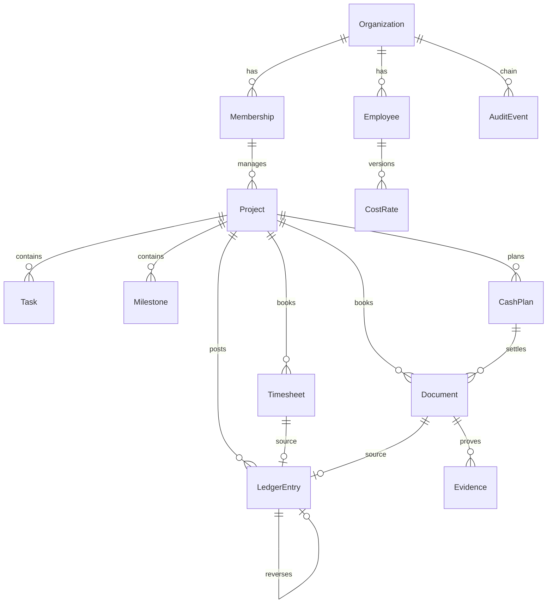
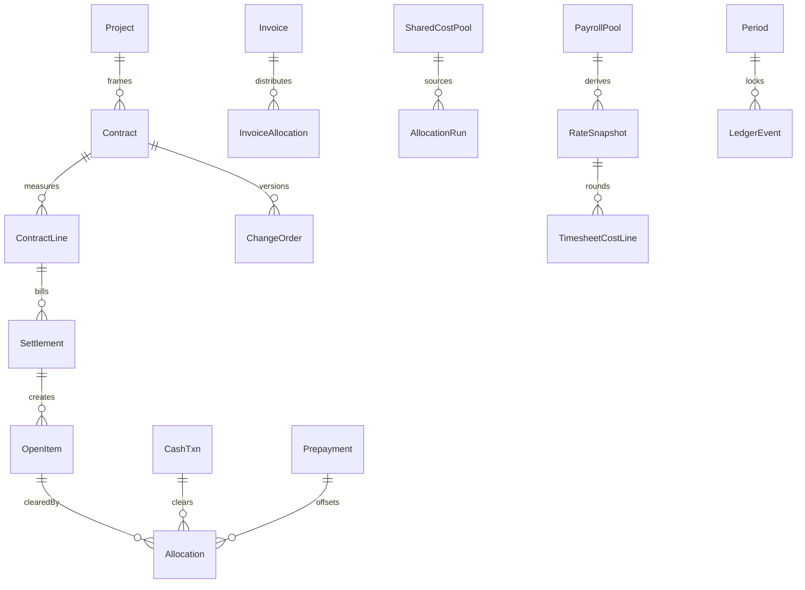
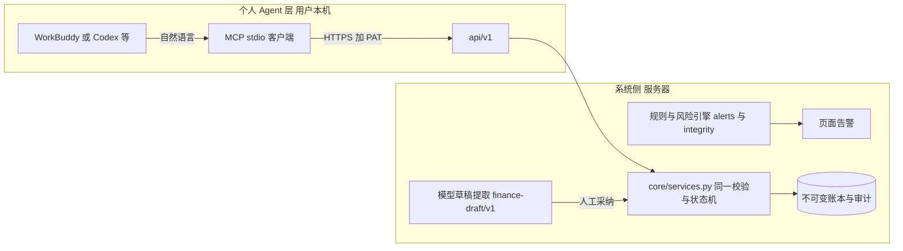
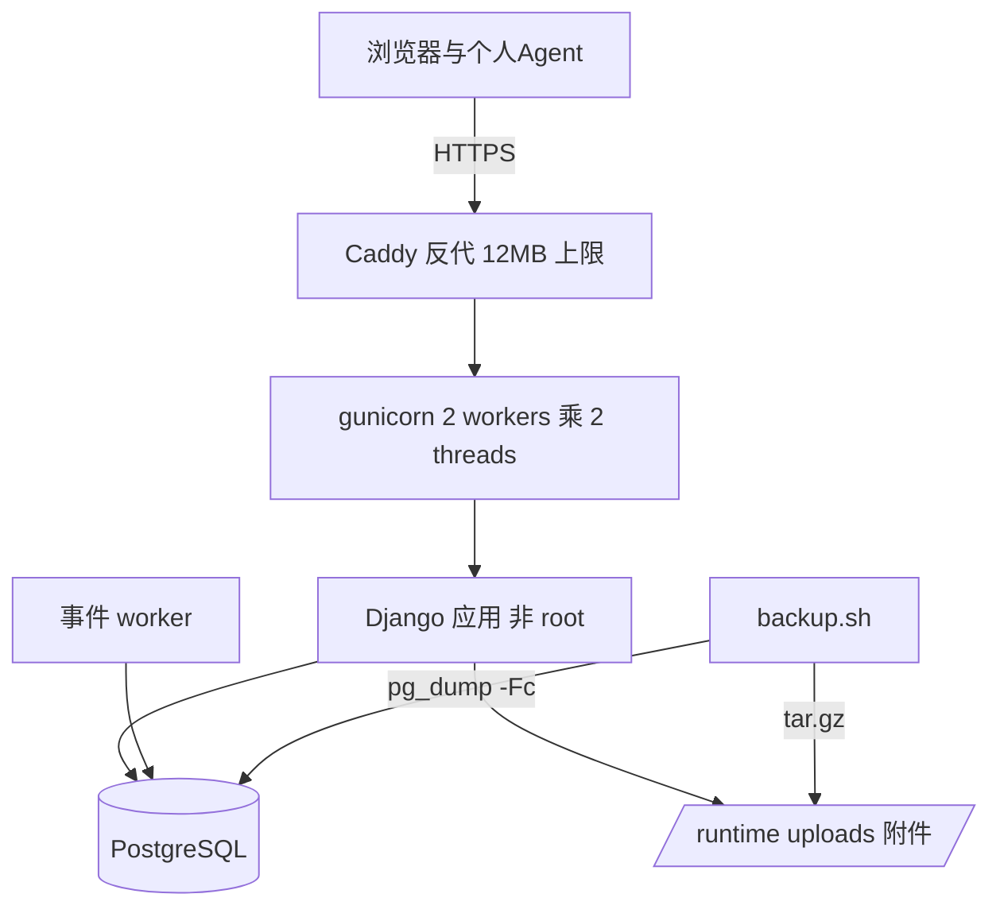

# 工程架构设计

任务ID：PMO-ENGINEERING-01
日期：2026-10-22
适用范围：面向中国大陆 100 人以下软件/实施/技术服务公司的单主体项目管理账。业务行为以 `product-requirements.md`、金额与核算以 `accounting-rules.md` 为准；本文承接二者的工程实现决策。本文区分「已实现」（与 `delivery-status.md` 一致）与「目标设计」（待工作单实现），不混写。

## 1. 约束与前提

- 客户没有财务系统、ERP 或 OA；所有核算事实必须能在本系统内手工录入、导入、审核和纠错。
- 自有服务器或云主机，浏览器访问；单主体、人民币本位币、Asia/Shanghai；项目管理账不做法定财务。
- 生产 PostgreSQL、本地 SQLite，两种库金额与状态迁移结果一致。
- 双层 AI 为已确认产品方向：系统侧 AI 做规则与核算引擎，个人办公 Agent（WorkBuddy/Codex 等）经安全 API 受权接入；任何一层都不直接执行付款、审批通过、费率生效、锁账。
- 开发依赖低成本模型完成边界清楚的任务，机制见 `development-contract.md`。

## 2. 架构决策记录（ADR）

### ADR-1 Django 单体 + 原生模板

单进程 WSGI（gunicorn）加 Django 5.2 原生模板/Auth/ORM/Forms；api/v1 使用 Django REST Framework 做严格 JSON 序列化与认证（唯一新增 Web 层依赖）。不引入 SPA 框架、微服务或消息队列作为首版依赖。依据：目标客户的运维能力是「一台服务器能跑起来」；审批、核算、权限都要求强一致事务，单体把它变成默认而不是额外工作。代价是前后端耦合与水平扩展上限，对 100 人公司量级（项目数百、年单据数万）足够。

### ADR-2 整数分 + 应用层 Decimal

金额持久化为有符号 64 位整数分；时间为整数分钟；乘除只在应用层用 Decimal，最终到分一律 ROUND_HALF_UP；单笔上限 10^12 分（A03.6）。禁止 binary float 进入金额路径，禁止依赖 SQLite 浮点聚合决定入账金额。展示层（`core/templatetags/money.py`）只做格式化。目标设计（A03）要求费率/汇率 8 位小数与取整组守恒（A04），当前实现为整数分费率加逐行 HALF_UP，差异与消除载体见 `delivery-status.md` 第 5 节。

### ADR-3 服务层是唯一写入口

工时、财务单据、审批、冲销和项目状态迁移集中在 `core/services.py` 的事务脚本；浏览器表单、CSV 导入与已实现的 api/v1 共用这些服务和金额规则。账户、附件、个人令牌与插件设置另有专门写入口，均需权限检查、事务和审计。新增业务插件采用相同规则，不在接口内复制核算逻辑。

### ADR-4 公司级写串行化 + 行级锁 + 乐观锁

业务写事务先 `select_for_update` 公司行（`lock_company`），再按需锁项目行/单据行；设计上由 PostgreSQL 串行化同公司的写。SQLite 的 `select_for_update` 无效，开发环境依靠数据库写锁，不能据此证明生产并发行为。用户可感知的冲突用实体 `version`（项目、任务）和幂等 token 解决。SQLite 顺序流程已测试；多连接并发和 PG 锁行为属 WO-10 验证项。

### ADR-5 不可变账本 + 负值冲销 + 数据库触发器兜底

`LedgerEntry` 与 `AuditEvent` 只追加；更正通过一对一挂接的负值冲销行表达，原行永不修改。应用层之外由迁移 0002 安装 UPDATE/DELETE 拒绝触发器（PG 与 SQLite 两套），防止运维手改和程序缺陷。SQLite 已实测；PG 触发器未实跑（WO-10）。

### ADR-6 租户隔离在查询层强制

单组织工作区：所有业务表挂 Organization；可见性统一经 `core/access.py` 的 `visible_projects` / `require_project` / `can_read_finance` 过滤，不在模板里藏按钮代替权限。验收标准是持有他租户真实 ID 时读、改、导出、下载全部失败（已有测试）。当前每用户取第一个有效成员关系，多组织切换为后续能力。

### ADR-7 双层 AI：系统引擎 + 个人 Agent 受权通道

系统侧：确定性规则引擎优先，模型只做结构化草稿且输出必须逐字回引证据；模型无写权限、无凭据接触业务工具。个人 Agent 侧：用户本机的 Agent 工具经 api/v1 + 个人令牌接入，权限收敛到「以本人身份提交本人数据到待审批」。两层都不可用时，全部核心流程仍可手工完成。详细契约见第 8、9 节。

### ADR-8 薄层自研，不整套二开 ERP

对照 ERPNext/OpenProject/Odoo/Plane 后选择薄层自研：只复用 Django、django-axes、WhiteNoise、psycopg、gunicorn 等通用组件，不复制任何业务源码。依据与改选条件见 `open-source-review.md`。

### ADR-9 派生读模型不持久化余额

项目汇总、组合指标、现金预测、告警在 `core/reporting.py` 从账本和单据实时计算；已发生成本、EAC、已收已付及计划未结额是派生值。收入确认与利润尚未实现，目标设计也要求从业务事实派生。目标多口径汇总（A24）需要随相应模块扩展只读完整性检查。

### ADR-10 插件化：稳定 kernel 与可替换业务插件

目标是按插件隔离可变业务，kernel 保留身份、权限、审计、账本不变式、outbox 与注册接口。当前 manifest 只声明版本、内核兼容、依赖、默认启用值和 capabilities 等 8 个字段；没有 scopes 授权引擎或数据 namespace 强制。已交付 pluggy 运行时与 3 个叶插件（13 项测试），按公司即时启停。outbox 处理器只产有界回执，洞察钩子只产提醒。同进程插件属于可信代码。业务模块抽离、独立迁移与页面注册仍是目标能力，详见 `plugin-architecture.md`。

## 3. 域模型与模块边界

### 3.1 当前模型（已实现）

要点：Project 承载阶段机、合同总额（占位口径）、预算与 ETC；Document 六类覆盖费用/收付/基线/变更/验收；LedgerEntry 三本分户账；审批动作即过账动作（review 内同事务生成账本行）。

### 3.2 目标模型（未实现，工作单载体）

新增对象按工作单落地：WO-01 Contract/ContractLine/ChangeOrder；WO-02 Settlement/OpenItem/Allocation（核销）；WO-03 Prepayment/Refund；WO-04 SharedCostPool/AllocationRun；WO-05 PayrollPool/RateSnapshot（8 位小数）/取整组；WO-07 Invoice；WO-08 OpeningBalance；WO-09 Period/通知/任务。多币种字段（原币整数、汇率 8 位）随 WO-02 起在新建对象上预留，完整外币核算为下一批。

### 3.3 模块边界

| 模块 | 职责 | 不得做 |
| --- | --- | --- |
| `core/models.py` | 表结构、约束、枚举 | 业务规则、跨行计算 |
| `core/access.py` | 成员解析、可见性、角色断言 | 写操作 |
| `core/services.py` | 全部写事务、状态机、金额计算、幂等 | HTTP、模板 |
| `core/reporting.py` | 只读汇总、预测、告警 | 写、缓存余额 |
| `core/forms.py` | 输入解析与表单级校验 | 落库决策 |
| `core/views.py` | HTTP 接线、权限入口检查、渲染 | 业务规则副本 |
| `core/imports.py` | CSV 解析、预览/提交、行级幂等 | 绕过 services |
| `core/ai.py` | 模型草稿与结构校验 | 写业务表（AIJob 除外） |
| `core/blueprints.py` | 三类模板的起始任务/里程碑 | 生成业务事实 |
| `core/api.py`、`core/agent_auth.py` | api/v1 视图、PAT 认证、scope 断言、幂等操作记录 | 业务规则副本（只调 services） |
| `integrations/mcp/`（独立依赖） | 本机 stdio 适配器 | 服务器秘密与模型凭据逻辑 |

## 4. 权限与租户

角色（已实现）：owner 公司负责人、pm 项目经理、finance 项目财务、member 项目成员、auditor 只读审阅。规则：读 = 角色允许 ∧ 项目范围允许；财务字段单独判定 `can_read_finance`；个人费率/依据与工时成本明细仅 owner/finance，PM 只见项目汇总成本与工时，auditor 不可见个人费率；导出按同一规则裁剪列。自审禁止在 `services.review` 强制，不能配置关闭。

目标设计（未实现）的扩展：财务录入/复核分离、付款授权人、代理审批、字段级授权矩阵、审批绑定内容哈希（D05、4.1、4.2）。这些改变 Membership 之外的授权模型，随 WO-02/WO-03 分批引入，不一次性重构。

## 5. 财务数据流、事件与不可变账本

三套口径（A01）到实现的映射：

| 口径 | 当前载体 | 目标载体 |
| --- | --- | --- |
| 项目经营（收入/成本/预算） | LedgerEntry.book=cost 加 Project.budget/etc | 增加 RevenueEvent、PayrollPool 分配、SharedCost 分配 |
| 结算与余额（应收应付/预收预付/质保） | 无（CashPlan 只是计划） | OpenItem 加 Allocation 加 Prepayment |
| 现金（实际收付/预测） | LedgerEntry cash_in/cash_out 加 CashPlan | 增加 CashTxn、待匹配区、预测来源升级 |

事件规则（已实现部分）：审批通过事务内同时完成权限/期间/来源唯一/余额检查、账本行生成、审计；任何一步失败整体回滚。冲销逐分反向复制原行并一对一挂接（A23 严格冲销的当前形态）。审计事件哈希链（previous_hash 到 event_hash）可由 `verify_audit` 离线整链校验，`verify_integrity` 补充来源一致、过账唯一、反向配对、计划未结额非负检查。目标设计按 A25 扩展统一核算事件模板（履约资产、已结算未履约、税额待处理等管理对方），该事件模型随 WO-02 引入。

## 6. 锁账、并发与幂等

- 锁账（当前）：Organization.locked_through 只能前移；锁期业务日期拒绝补录；冲销落在开放期；锁前存在锁期待审记录时拒绝锁。目标（A23）：期间对象、双人锁账、锁定快照与「当时数/含调整数」双视图，后续批次。
- 幂等（已实现）：表单隐藏 UUID token；同 token 同内容返回原记录、改内容拒绝；CSV 行级 uuid5（租户加类型加来源ID）；LedgerEntry.posting_key 唯一；同项目同类型同来源编号查重。
- 并发机制（代码已具备，真实多连接并发未验证）：公司行锁、单据行 select_for_update、项目/任务 version、锁内重查计划未结额（plan_remaining）。SQLite 已通过顺序流程和过期对象重读测试；PG 才能验证设计的行锁效果。核销保护随 OpenItem/Allocation（WO-02）扩展，P10/T22 在 PG 实跑（WO-10）。

## 7. 接口契约

### 7.1 浏览器表单（已实现）

URL 清单见 `pmo/urls.py`；写端点全部 POST 加 CSRF；表单金额以元输入、最多两位小数，服务层 `cents()` 统一转分并拒绝三位小数与超限。测试已证明 GET 不产生变更、无 CSRF 拒绝、匿名与越权拒绝。

### 7.2 CSV 导入导出（已实现）

导入三类（time/expense/plan）：UTF-8、不超过 2MB、不超过 500 行、列头精确匹配；预览为整体回滚的试算，提交为整批全或无；行级错误带行号。导出四类（ledger/plans/time/projects），UTF-8 BOM、公式注入转义、按角色裁剪列（见第 4 节）。

### 7.3 api/v1 JSON API（已实现，17 项测试于 SQLite）

面向个人 Agent 与脚本的第一方 API，DRF 实现，端点：`/api/v1/me`、`/api/v1/projects`、`/api/v1/projects/{id}`、`/api/v1/projects/{id}/tasks`、`/api/v1/timesheets`、`/api/v1/expenses`、`/api/v1/tasks/{id}/status`；URL 主键经 SafeIdConverter 限长（最多 18 位数字）。已实现契约：

- 认证：仅 PAT（Authorization: Bearer），浏览器会话 Cookie 与查询串令牌对 api/v1 无效（有测试）。
- 严格 JSON：未知字段拒绝；整数/布尔必须严格类型，字符串数字与布尔串拒绝（有测试）。
- 写端点全部要求 `Idempotency-Key`（8–100 字符）；同键同负载返回首个结果，同键不同负载 409（AgentOperation 记录键哈希与负载哈希，有测试）。
- `dry_run` 默认 true：只做校验与预演，业务、审计、操作记录整体回滚（有测试）；显式 false 才落库，返回 202。
- 金额以整数分字段传输（amount_cents，上限 MAX_MONEY），不存在靠数值猜单位。
- 所有写经 `core/services.py` 同一服务层；API 无规则副本。
- 速率限制：每令牌 60 次/分钟，超限 429（有测试）；响应 no-store 并带 X-Request-ID。

### 7.4 系统侧 AI 端点（已实现，真实模型未验证）

OpenAI 兼容 chat/completions；服务端凭据仅存环境变量；结构化输出契约 `finance-draft/v1`：字段白名单、金额十进制字符串、日期必须原文明确、项目编号必须从允许列表取且原文出现、证据逐字回引原文、缺失字段自报；服务端另强制推导缺失项，不信任模型自标完整。超时 25 秒、响应 64KB 上限、无重试；失败不生成单据。AIJob 记录请求人、模型、输入摘要与结果；尚未建立草稿到最终单据的采纳关联。

## 8. 双层 AI 结构合同与安全边界

### 8.1 分层职责

- L1 系统侧：确定性规则引擎（告警、门禁、完整性检查）为默认能力，不依赖模型；模型只做草稿建议，输出必须过 `validate_draft`，人工采纳后才进入正常单据流。
- L2 个人 Agent：运行在用户本机，模型凭据在用户自己的 Agent 工具里，服务器不持有、也不需要个人模型凭据；Agent 通过 MCP stdio 客户端拿到一组受限工具，把自然语言转成 api/v1 调用。
- 两层共同禁区：审批通过、付款、锁账、费率生效、角色/权限变更、他人数据读取。这些动作没有 AI 通道，只有浏览器内人类操作。

### 8.2 PAT 设计（已实现）

| 属性 | 实现（core/agent_auth.py、core/api.py） |
| --- | --- |
| 存储 | 只存 HMAC-SHA256（以 SECRET_KEY 为钥），明文仅创建时页面展示一次；前缀 12 字符用于识别；审计不记录明文（有测试） |
| 签发 | 设置内「接入」页面，须输入当前登录密码，经 Django authenticate 校验（走 axes 暴力猜测限流）；最多 10 个有效令牌 |
| 绑定 | 成员加 auth_snapshot（Django 会话认证哈希）；密码变更、成员停用、用户停用、撤销、过期均即时失效（有测试）；每次请求与每次写操作重查 |
| 项目范围 | 签发时从本人可见项目中显式勾选；每次请求重算可见性，项目授权被收回即 403（有测试） |
| 工具 scope | 见 8.3；签发范围不得超出当前角色允许集合；每次请求取令牌 scope 与当前角色交集，角色降级即时生效（有测试） |
| 有效期 | 7、30、90 天三档 |
| 撤销 | 本人在接入页面撤销，即时生效 |
| 审计 | 读与写均记审计（含令牌 ID、request ID、幂等键哈希）；写操作进审计哈希链 |
| 频率 | 每令牌 60 次/分钟（自 window_start 起的固定窗口计数），超限 429 |

### 8.3 scope/action 矩阵（已实现并冻结）

| scope | 允许动作 | 服务端强制 |
| --- | --- | --- |
| projects:read | 授权项目列表与详情（编号、名称、阶段、日期、范围、里程碑） | visible_projects 加令牌项目集合；无金额字段 |
| tasks:read | 授权项目任务列表（状态、负责人、是否本人、version、依赖） | 同上 |
| time:write_self | 提交本人工时到待审批 | submit_time 同一校验；employee 强制为绑定本人的员工记录，伪造员工字段拒绝（有测试） |
| expense:write_self | 提交本人费用到待审批 | submit_document kind=expense 同一校验；不能创建付款或审批（有测试） |
| tasks:write_self | 更新本人负责任务状态 | update_task 同一校验与乐观锁；重复提交不推进 version（有测试） |
| finance:read_summary | 授权项目财务汇总（项目级分币合计） | 签发与每次请求都重查 can_read_finance；个人费率/成本明细永不出现在 API（有测试） |

不存在任何审批、冲销、收付款登记、锁账、角色管理、费率读写、导出路由（有测试证明路由不存在）。请求超出 scope 一律 403，不提示对象存在性；跨租户项目返回 403/404（有测试）。

### 8.4 Prompt injection 与多租户防护

- Agent 提交的一切内容按不可信数据处理：进入与表单完全相同的 ValidationError 规则；系统不把 API 负载、工时说明、费用标题中的任何文本当指令执行。
- 工时说明与费用标题等自由文本入库后，在系统侧 AI 摘要等场景再次被引用时，仍按不可信资料处理（与 finance-draft/v1 的 SYSTEM 约定一致）。
- 租户隔离：PAT 绑定用户，项目范围逐请求经 `visible_projects` 重算；持有他租户 ID 返回 404 或 403 且不暴露存在性；禁用用户令牌即时失效。
- 数据最小化：响应只含 scope 内字段；项目读不含金额；工时不含费率成本；错误消息不泄露他人数据。
- 确认与来源：工具说明要求个人 Agent 在提交前复述项目、日期、金额或时长并取得明确指令；工具默认 dry_run。服务端强制权限、校验和待审批状态，但无法证明个人客户端是否完成了对话确认。API 响应携带单据 token 与状态，未审批记录仍走原有审核流程。

### 8.5 MCP 客户端与演进（已实现首版，未做真实客户端联调）

首版为本机stdio适配器（integrations/mcp/）：官方Python MCP SDK（FastMCP），用户在本机安装，配置 `PMO_AGENT_TOKEN`（仅进程环境变量）与 `PMO_BASE_URL`，把8.3的能力暴露为7个工具。已实现边界（8项测试）：base URL拒绝凭据/查询串/非HTTPS，本机HTTP需显式 `PMO_ALLOW_LOCAL_HTTP=1`；写工具默认dry_run；不跟随重定向；错误有界并遮盖令牌；成功载荷移除费率字段；严格整数在发网前拒绝。工具描述要求复述业务事实并取得提交指令，这是客户端行为约定，服务端没有独立的人类确认凭据。服务器不持有个人模型凭据；当前没有远程MCP服务。

未来若提供 MCP server（多用户托管）：OAuth2.1 加 PKCE 授权码流程、token audience 绑定到本服务、按 8.3 scope 授权、必要日志脱敏（不记录 PAT 明文、不记录自由文本全文）。该演进是独立设计评审项，不随首版承诺。

## 9. 部署拓扑与运维

### 9.1 拓扑（目标，件已在仓库、未验证）

环境变量：`PMO_ENV=production`、`DJANGO_SECRET_KEY`（不少于 40 字符）、`POSTGRES_*`、`DJANGO_ALLOWED_HOSTS`、`DJANGO_CSRF_TRUSTED_ORIGINS`、可选 `PMO_AI_*`。生产缺 PG 或弱密钥直接拒绝启动。compose.yaml 提供 db/app/worker/proxy 四服务；worker 执行 `process_events --watch`。容器构建、编排启动与生产备份未实跑，属 WO-10。

### 9.2 备份、升级与回滚

- 生产备份（待验证）：停 app 与 worker、pg_dump -Fc、附件 tar.gz、SHA256 清单；`.env` 独立保管。恢复验收：新环境能登录、打开原凭证、verify_integrity 通过、报表数字一致。本地 SQLite 使用专门的 `backup_local` 与隔离恢复脚本，已验证 47 条账目和 1 个附件，详见 `local-backup.md`。
- 升级：迁移只追加不改历史语义；append-only 触发器随迁移重装；升级前先备份。
- 回滚：应用回滚到上一镜像；数据库不回滚（迁移向前兼容约束），确需回退时用升级前备份恢复并接受期间数据损失——该约束写入 WO-10 验收。

### 9.3 性能目标与监控

规模假设：单组织不超过 100 用户、300 项目、年单据 5 万、账本 20 万行。目标：主页面 P95 小于 800ms（本机 SSD 加 PG）；汇总查询全部走索引过滤，禁止 Python 侧全表聚合；`health/` 提供数据库探活；审计链与完整性用 `verify_integrity --json` 定期离线跑；gunicorn 访问与错误日志落 stdout 由容器收集。当前已知风险：`project_summary` 对组合页逐项目聚合，项目数上去后需物化汇总或缓存（后续批次，非首版阻断）。

## 10. 可插拔输入

输入适配器统一契约（目标）：任何外部输入（浏览器表单、CSV、api/v1、未来 OCR、银行 CSV、银行直连）都必须实现「解析为结构化草稿、同一服务层校验、同一幂等键体系、人工或既定规则提交」。OCR 只产出字段草稿并保留原图哈希；银行 CSV 进待匹配区，不因缺项目丢失（A22）。适配器不得绕过业务服务或引入第二套金额解析。已交付表单、三类 CSV、api/v1 与本机 MCP；OCR 和银行 CSV 尚未实现。

## 11. 通用与行业能力分层

- 通用核心（与行业无关）：组织/成员/角色、权限与审计、不可变账本、审批与冲销、金额/时间契约、导入导出、锁账、api/v1 与 PAT、双层 AI 框架。
- 行业层（软件/实施/技术服务）：`core/blueprints.py` 三类模板的任务链与里程碑（已实现骨架）；目标设计的收入计量方法、服务期/包量、实施站点结算（A12、需求文档第 8 节）随 WO-01/WO-02 引入，按模板互斥配置。
- 规则编号（A01–A25、P01–P15、T01–T29、D01–D08）是通用核心与行业层共同的验收语言；每个工作单声明覆盖的编号。

## 12. 数据契约冻结清单

以下契约一经冻结，工作单不得修改；变更走 `development-contract.md` 第 7 节：

1. 金额：持久化整数分；输入十进制字符串不超过 2 位小数；计算 Decimal 加 ROUND_HALF_UP；单笔上限 10^12 分、输入提示 100 亿元（已与 A03 一致）。
2. 时间：整数分钟；业务日期不晚于今天（收付计划除外）；锁期由服务端判定。
3. 状态机：项目 TRANSITIONS、单据与工时 submitted 到 approved/rejected 到 reversed、计划 approved/rejected/active 组合，枚举值只增不改。
4. 不可变：LedgerEntry、AuditEvent 只追加；冲销为一对一负值行；审计哈希链含 created_at。
5. 幂等：表单/导入/API 三通道统一 token 语义——同键同内容返回原记录，同键不同内容拒绝；uuid5 导入键含租户。
6. 权限：读 = 角色与项目范围同时成立；财务字段单独判定；自审禁止不可关闭；个人费率仅 owner/finance。
7. API（WO-11 冻结）：8.2 与 8.3 的 PAT 属性与 scope 矩阵；Idempotency-Key 与 dry_run 语义；金额双单位命名。
8. AI：finance-draft/v1 输出契约；模型无写权限；服务端凭据不出环境变量；个人模型凭据不进服务器。
