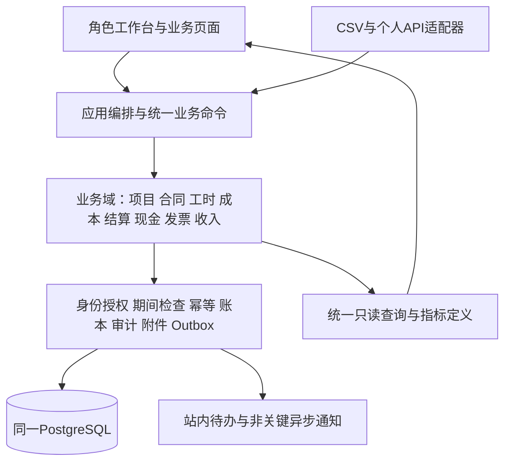
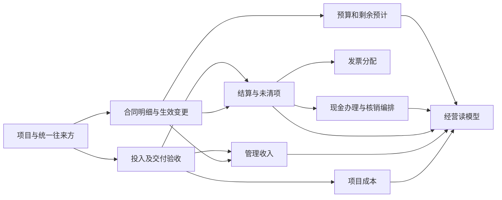

# Project Hub 1.0 正式客户版本交付方案

文档版本：1.0 交付方案初稿（供产品负责人评审）  
编制日期：2026-10-27  
目标产品：面向 5～50 人项目型软件及服务公司的项目经营核算软件  
冻结代码基线：`119a04916e3e96a5e4d86516a5f13e841faf2f67`，标签 `freeze/product-definition-2026-10-27`  
配套文档：[简化功能模块清单](v1.0-feature-list.md)

> 本文定义第一个可正式交付客户的 **1.0 目标产品及交付条件**，不表示当前工程验证版已具备这些能力。当前代码继续冻结；本文不改变版本号、财务口径、旧任务状态、现行规范或实施授权。文内需求编号是产品追踪编号，不是可直接开工的 PH 任务。评审后须先通过独立规划 PR 冻结业务契约、文件范围与依赖，再分批实现。

## 1. 产品目标与交付承诺

### 1.1 产品定位

帮助缺少经营分析能力、没有业务系统或主要依赖 Excel 的小公司，以可持续的录入和核对习惯，及时看清项目成本、收付款、预计完工结果与风险。用户无需先建立 ERP、OA 或专业财务系统，核心事实可在本系统手工登记、导入、审核和纠错。

产品同时交付：可用软件、适合小公司的核算模板、从零开账/存量承接方法、操作指引、部署升级和恢复手册。核算方法放在规则与服务层，界面只要求用户提供业务事实、证据和必要判断。

### 1.2 1.0 必须让客户独立回答的问题

| 问题 | 交付结果 | 明确边界 |
| --- | --- | --- |
| 每个项目已经花了多少？ | 可追溯的已确认成本、暂估及未入账风险 | 已付款不等于已发生成本；缺资料不填假零 |
| 做完还要花多少？ | 分项、带来源和日期的剩余投入预计 | 是管理估计，不能当实际支出或会计预计负债 |
| 做完预计剩多少？ | 已生效收费范围减预计完工成本，区分直接成本与分摊后结果 | 不把合同额、预算余额或净现金流称为利润 |
| 已经完成的服务带来多少管理收入？ | 按已确认方法和履约依据生成的管理收入及调整 | 独立于开票与到账；不是法定财务报表和纳税申报 |
| 谁欠公司钱，公司还欠谁？ | 正式结算、未清项、预收预付、核销及账龄 | 条件计划不冒充无条件债权债务 |
| 接下来什么时候需要钱？ | 13 周收付预测、逾期待跟进及日期未定事项 | 项目净现金流与银行余额分开；公司资金预测有完整范围前提 |
| 为什么项目都赚钱，公司仍留不下钱？ | 项目、非项目、共享与待分配成本可与公司汇总核对 | 不通过强行分摊掩盖空闲、售前和管理成本 |

### 1.3 首批用户与交付范围

总体面向 5～50 人，首批优先验证 10～30 人、多项目并行、人工成本占重要部分的实施、定制开发和技术服务公司。首批切口是假设，须由真实访谈与试用验证，不用国外厂商调查替代国内用户证据。

1.0 提供三种经过验收的收费模板：固定总价/里程碑、按确认人天或工时、固定服务期。模板只是同一合同明细模型的计量策略，不能各建一套项目/成本/现金台账。包量超额等复杂变种未明确建模前不承诺支持。

统一范围：一个企业对应一个核算主体、人民币、中文、Asia/Shanghai；浏览器使用；自托管独立实例，可提供部署及代运维服务。业务人员独立使用不等于要求非技术客户独立维护数据库。一个人可以兼任多个职责，但正式生效记录必须满足已有禁止自审规则。

### 1.4 不列入 1.0 的能力

多法人合并、多币种核算、法定总账/报税、工资发放与个税计算、银行直连及自动支付、复杂库存/制造、完整 CRM/OA、电子签约、客户门户、复杂资源优化、插件市场。轻量采购只覆盖项目外部支出及服务验收，不承诺仓储存货核算。

保留现有个人 API、MCP 与 AI 技术资产，但 1.0 核心流程必须在无模型、无外部 Agent 时完整可用；新 AI 能力和新客户端不成为本产品首个正式版本的必要前置。此项与旧 PH-020/017/018 依赖的差异须经后续规划 PR 明确调整，本文不自行取消旧依赖。

## 2. 角色、职责与工作节奏

| 职责 | 主要动作 | 可读范围及限制 | 建议节奏 |
| --- | --- | --- | --- |
| 老板/负责人 | 确认经营规则、预算与重大变更，查看项目/公司结果，分派异常处理 | 公司经营信息；个人工资明细仅明确授权人员 | 每周看异常，每月确认核对结果 |
| 项目经理 | 建项目、交付节点、范围变化、核对投入、更新剩余工作、发起验收与结算 | 所授权项目；可看项目汇总，不能看到个人薪酬费率明细 | 每周更新，节点发生时办理 |
| 员工 | 登记本人工时、费用和交付证据，处理退回 | 本人记录与被授权项目；无个人费率或财务审批权 | 日常简填、每周补齐 |
| 核对人员/财务 | 工资与成本配置、外部支出、结算、银行流水、核销、发票、核对及期间操作 | 按权限处理财务；提交人与复核人分离 | 业务发生时处理，每月核对 |
| 只读审阅 | 核查证据、报表和审计 | 依现有 auditor 授权；个人费率/人工明细继续遮蔽 | 按需 |
| 运维人员 | 部署、备份、升级、恢复、账号技术支持 | 无默认业务审批权；敏感运维访问留痕 | 按服务约定 |

员工与登录账号是不同对象：无账号的员工可由授权人员代录，必须保存业务本人和代录人。人员离职不删除历史记录；账号停用、员工停用、项目移除分别产生明确影响。最小客户组织需要至少两名可承担制单/复核的授权人员，不能为了小公司方便允许自审；角色兼任不豁免服务端分权。

## 3. 范围、优先级与需求规范

- **M（Must）**：1.0 正式交付范围，必须完成对应验收，不得作为上线后待补。
- **E（Extension）**：后续扩展，明确不进入首版承诺。
- 后续表格全部为 M。实现可分波次，波次先后不改变最终必交付范围。
- 每条需求应进入追踪表：编号、业务角色、规则、唯一数据源、依赖、验收用例、实现 PH 任务、证据链接、未验证事项。
- 业务政策不明确时先给可审核的方案与反例，产品负责人确定。技术目录、锁顺序和接线由集成者按已冻结契约处理。

## 4. 总体架构：一套业务事实，多种使用视图

### 4.1 架构选择

保留 Django 模块化单体、原生模板、DRF、PostgreSQL；开发环境保留 SQLite。首版不新增微服务、前端构建链、消息中间件或数据仓库。复用现有 Auth、权限、账本、审计、幂等、附件、Outbox、唯一基础资料服务和只读汇总。

业务域按数据所有权划分，同一数据库、同一部署、关键写入同一事务。新增合同、结算等业务在受信 Django 插件 App 中实现，遵循 [业务插件演进](plugin-evolution.md)；先完成必要 SDK 契约，再建新域。不为每张表创建插件，也不以全量搬迁旧 core 为交付前提。页面模块与 Django App 不要求一一对应。



这张图表示目标职责，非当前目录或已部署服务清单。金额、核销、收入成本、现金及审计在同步事务内生效；Outbox 只用于通知等允许延迟的副作用，不能承担最终记账的一致性。

### 4.2 页面与数据维护分离

“基础资料”“项目详情”“经营概览”等是入口。一个项目在多个页面出现，均读取同一个 Project；允许从不同页面打开同一标准维护表单，但最终调用同一服务，不保留第二套写规则。汇总页、图表、导出均从同一授权查询获取相同口径。

### 4.3 业务对象唯一所有权清单

| 业务对象/事实 | 唯一维护方（目标逻辑域） | 其他模块如何使用 | 禁止出现的第二套维护 |
| --- | --- | --- | --- |
| 企业、账号、成员、角色、项目授权 | 身份与授权；复用现有模型/服务 | 全部业务引用组织和成员稳定 ID | 各模块自建用户/角色表或共享管理员凭据 |
| 员工及账号绑定 | 现有基础资料 Employee 服务 | 工时、费率、工资批次引用 employee_id | 工时模块再建同名员工，工资导入另建人员台账 |
| 客户/供应商/其他往来方 | contracts 的统一 Counterparty 服务（目标） | 合同、结算、现金、发票引用同一往来方 ID；客户/供应商是可兼具的角色 | 发票客户、收款客户和项目客户分别手录成三个人 |
| 项目标识、负责人、成员和属性 | 现有 Project/masterdata 服务 | 所有业务通过 project_id 关联 | 合同/财务重新建一套项目档案 |
| 合同、明细、批准变更、生效价款及收入方法选择/业务政策版本 | contracts | 项目详情、结算、收入和预测只读已批准版本 | Project.contract_cents 与正式合同额长期双写并分别可编辑 |
| 交付节点、验收证据、实际服务确认 | delivery；旧表先保留 | 合同计量、结算和管理收入引用验收/服务确认 ID | 收入、结算各自重新录一份验收事实 |
| 工时/投入记录、可计费确认 | time；基于现有 Timesheet 逐步扩展 | costing 读取已批准投入，收费计量引用其子集/调整依据 | PM表、工时表、工资表各维护一套实际投入 |
| 工资成本池、费率快照和成本分配运行 | costing 的人工/分配子域 | 成本过账、报表和月结引用版本及分配结果 | 费用模块再录工资成本；报表自带可编辑分摊余额 |
| 项目外部支出承诺、费用、共享费用来源与验收事实 | costing 的外部支出子域（目标，复用现有单据适配） | settlement 依据已确认来源建立义务，现金引用应付办理 | 采购、报销和付款各自再记一次实际成本 |
| 结算、未清项、折让/坏账等更正、核销关系 | settlement | cash 经服务办理核销；发票/收入引用结算行 | CashPlan 被改造成第二套应收，现金页手工修改未清额 |
| 资金账户、银行现金事实、预收预付、退款 | cash；旧实际现金账经适配保留 | settlement 引用资金来源标识；报表按核销/归属读取 | 核销再建银行流水；项目现金与银行流水分别登记同一实际到账 |
| 发票及发票分配/红冲关系 | invoicing | 引用往来方、合同/结算/费用来源 | 开票自动新增已有应收、采购发票自动再增已有成本 |
| 管理收入事件、执行算法与调整 | management_revenue；合同方法选择只引用contracts批准版本 | 依据合同明细和履约事实；insights 只读 | 结算、发票和收款分别重复增加收入 |
| 成本预算版本与剩余预计版本 | costing/planning 子域；统一入口 | 项目只读批准基线；insights 读最新有效预计 | 项目预算字段、合同预算表和看板预算独立编辑 |
| 现金预测来源/日期修订 | cash；金额来自业务来源，人工估计单列 | insights 只读统一预测集 | 从合同复制一条计划、结算又加一条、应收再加一条重复预测 |
| 期初事件及历史覆盖范围 | 启用编排调用各域专用期初命令 | 各业务域按同一批次引用并校验 | 导入系统保存一套可独立修改的期初余额 |
| 账本、期间控制、审计与核算来源 | 共享内核，遵守既有边界 | 各域提交带来源的核算事件；查询只读 | 任何插件或报表直接改历史余额、删除凭证 |
| 经营指标与报表 | insights/reporting 统一只读模型 | 页面、导出、图表、受权 API 共用定义 | 图表自行算利润，下载Excel另写公式口径 |

未实现对象的名称为产品逻辑名，最终 schema、App 归属和接口需规划冻结，不能把此表直接当建表脚本。员工报销、借支和工资收付直接引用既有 employee_id；支付对象需要统一引用时采用受控的类型与稳定ID，不为了付款把员工再复制成一份供应商档案。

### 4.4 关联与依赖契约



箭头表示事实被下游引用，不表示所有外键或调用方向。Django App 的依赖必须保持可解释的单向图：

1. contracts 只依赖稳定企业/项目与授权接口，不反向 import cash、settlement 或 insights。
2. settlement 依赖 contracts 和共享内核；既不依赖现金模型，也不因新增收款重建合同。
3. cash 可以依赖 settlement。核销由应用编排启动：同一公司锁和事务内验证现金可用额与未清额，分别调用资金域与结算域命令；**核销关系只由 settlement 登记**。结算只引用内核核算来源 ID/版本化资金引用契约，不能反向 import CashTxn。资金可用额和核销事实不能靠双向异步消息互相追赶。
4. 外部支出验收事实由成本域输出；结算引用该事实建立应付。成本域不直接写应付表，结算不重复确认验收成本。跨域编排只调用各自服务。
5. management_revenue 依赖合同与履约查询；**收入方法选择及业务政策版本由contracts唯一维护**，管理收入域只保存其不可编辑引用/批准快照、执行算法版本及收入事件，不提供第二个修改合同计量方法的入口。合同通过SDK声明的策略标识校验可支持方法，不反向import收入模型。履约与结算的配对由固定编排/读模型引用两侧稳定标识，不令交付域依赖收入模块。
6. insights 和 onboarding 是组合层：前者只读；后者只调用各域命令。各基础域不得反过来依赖工作台或初始化页面。
7. 不同业务对象之间允许受控分配桥表，必须声明所有者、币种/项目/对手约束、来源金额和有效分配上限。不得把“多对多”实现成各模块可手改的相同余额字段。
8. 既有 Task 对 CashPlan 的外键先留在原 core 模型与迁移中；抽离交付命令时通过已声明的计划查询/来源接口校验，不为移动这张旧表制造 delivery→cash→settlement→delivery 的循环。若最终目录需要调整跨域来源契约，先由SDK规划冻结，不在业务实现中临时反向import。

### 4.5 统一写入、版本与只读快照

统一链路：输入解析 → 当前授权 → 幂等/乐观版本 → 公司锁/期间检查 → 业务事实确认 → 原子核算/分配 → 审计/Outbox → 返回结果。UI、导入、API、后台任务全部共用；禁止后台为“方便”绕过服务。

允许保存批准时的名称、价格、费率、税额、计算参数和附件哈希快照，目的为解释历史；快照不可独立编辑，不反向覆盖主数据。合同修订、费率变更和错账更正均保存新版本/调整；旧版历史按原事实解释。页面显示当前名称时也应能回查批准快照。

余额、累计成本、已核销和汇总金额由有效事件派生；若为性能使用投影，必须可重建、保存来源水位并显示更新状态，不能成为第二个手改事实源。首版优先实时授权查询，不先引入独立报表库。

### 4.6 历史资产接入规则

现有 Project、Employee、Timesheet、Document、LedgerEntry、AuditEvent、CashPlan 的表/主键/已应用迁移保留。新域建立与旧事实的一一对应及来源索引；旧入口只转发新服务。切换前做同一合成夹具逐分比对，写入口同一时点只有一个权威方，不长期双写。

正式合同启用后，Project 旧合同额只能显示经映射的只读值或明确历史值；CashPlan 保留为计划/历史核销兼容载体，不能无转换把其剩余值当未清应收。转换需逐来源核对与批准，禁止自动根据同金额猜测关联。

## 5. 数据生命周期与必须打通的业务链

### 5.1 固定价项目：从收费到经营结果

项目 → 合同明细/生效变更 → 履约/验收事实 → 按合同条件发起结算 → 未清应收；管理收入从履约事实独立生成，并通过合同明细/来源配对；发票引用结算/履约来源；真实收款进入资金账 → 核销/预收抵扣 → 更新未清与未来预测。核销、开票、到账均不再次生成管理收入。

### 5.2 工时：一份投入支持两种不同计量

员工投入 → 审核 → 生效日费率快照/成本版本 → 人工成本。按时收费时，再以同一投入来源形成客户可计费确认（允许合同约定的扣减），引用对外售价形成履约/结算依据。内部成本费率与对外计费率不是同一字段；成本分钟和客户确认分钟是不同事实，不能各自重录一份工时。

### 5.3 外包和费用：承诺、成本、应付、付款分离

外部支出承诺 → 验收/费用发生确认 → 成本与同来源应付 → 付款/预付抵扣 → 核销。承诺转已发生时释放对应未履约预计；发票补入只确认票税资料，不再次增加同一成本或应付。外包人员按供应商合同记成本，其投入不能再套员工费率。

### 5.4 工资与共享费用：归集和分配不能双计

工资成本池 → 费率/工时分配 → 项目/非项目/未分配人工成本；工资实际付款走现金，不再生成一笔项目成本。共享费用来源 → 分配运行 → 项目/非项目去向；公司汇总计来源一次，项目汇总计分配结果，不能把来源池与去向再次相加。

### 5.5 现金预测：来源升级替代，部分转换要拆分

同一来源链按照“实际执行部分、正式未清、已批准义务计划、合同条件计划、人工预计”维护互斥覆盖范围。例如 100 元计划形成 60 元应收，其余仍未达条件，则预测是应收 60 加条件计划 40；收回 20 后未来仅剩 40 加 40，实际另列 20。不能同时保留全额计划 100 与应收 40。预收抵扣减少未来应收，不生成新现金。

过期未执行计划单列并要求负责人更新，不自动移动到本周。无日期的余额单列“日期待定”。保守情景只调整预测假设，不改法定或业务债权债务余额。

### 5.6 资金账户与项目分配

同一银行事实只登记一次。允许一笔银行流水分配到多项目或多未清项；项目归属不改变银行总额。内部账户互转成对关联，公司净现金流抵销，不算项目收入/费用。账户期初、非项目交易、未匹配交易齐备并核对后才展示“该覆盖账户范围的余额/资金预测”，否则只展示已登记项目现金。

## 6. 详细功能需求

### M01 企业、账号与权限

| 编号 | 需求与用户操作 | 数据关联和关键规则 | 验收要点 |
| --- | --- | --- | --- |
| V1-ORG-01 | 建立企业、起账日、币种、时区与核对负责人 | 企业为唯一租户；发生正式账后不直接改主体和本位币 | 拒绝重复接管；缺基础规则无法正式启用 |
| V1-ORG-02 | 创建账号、设置初始激活和密码恢复 | 复用现有账号；激活/恢复凭据有期限、一次性且不写明文日志 | 过期链接、重复使用、枚举账号有拒绝路径 |
| V1-ORG-03 | 分配角色与项目范围，支持多人兼任职责 | 服务端同时验证角色、项目、敏感字段；账号角色不代表全项目权 | 越企业/越项目读取、写入、导出和附件均拒绝 |
| V1-ORG-04 | 管理账号与员工关联 | 绑定单一有效员工身份，保留代录人 | 有账号无员工或无项目时给明确办理路径 |
| V1-ORG-05 | 离职、停用和重新启用 | 历史保留；立即撤销当前会话/令牌及新写权限 | 停用后的旧会话、PAT和后台任务不能继续写 |
| V1-ORG-06 | 查看权限与敏感资料读取记录 | 工资、个人费率和明细严格遮蔽，不能藏在HTML/context/导出 | PM/成员/审阅拿不到个人成本明细 |
| V1-ORG-07 | 配置最小两人分权与交接负责人 | 制单/本人业务不得自审；负责人离职前完成交接 | 同账号多角色不能规避自审；不能移除最后有效负责人 |
| V1-ORG-08 | 查看并撤销个人接入授权 | 保留本人、scope、项目、期限及默认dry_run规则 | 角色降级/密码变更/停用立即失效；无审批/支付/锁账工具 |

### M02 统一基础资料

| 编号 | 需求与用户操作 | 数据关联和关键规则 | 验收要点 |
| --- | --- | --- | --- |
| V1-MD-01 | 统一维护项目主档 | 现有 Project 稳定ID；各页面转向同一命令 | 项目页与财务/合同引用更新一致，旧POST不保留第二写规则 |
| V1-MD-02 | 统一维护员工、岗位、生效和停用日期 | Employee 与账号分离，工资/工时引用同ID | 同名员工不自动合并；历史投入不丢失 |
| V1-MD-03 | 统一维护往来方与联系人 | 一实体可兼客户/供应商；同企业内查重和人工确认 | 收付、合同、发票选择同一ID，不靠名称匹配核销 |
| V1-MD-04 | 管理成本类别、非项目去向和单位 | 共享字典版本，停用不删除历史引用 | 导入与UI单位一致，拒绝不明确的小时/分钟和元/分 |
| V1-MD-05 | 维护资金账户及账户责任人 | 唯一归属企业；余额从期初和交易派生 | 不能直接编辑当前余额，非授权人不可查看账号敏感信息 |
| V1-MD-06 | 修正重复和错误主数据 | 未引用记录可作废；已引用合并须映射及审计，禁止直接删历史 | 合并前列影响范围；租户/主体不同不能合并 |
| V1-MD-07 | 从业务表单快速选择或申请新增资料 | 调用原资料域表单/服务，按权限办理 | 无权人不能通过快捷新增获得维护权限 |

### M03 项目、交付与结项

| 编号 | 需求与用户操作 | 数据关联和关键规则 | 验收要点 |
| --- | --- | --- | --- |
| V1-PRO-01 | 建项目，选收费模板、负责人、客户和起止日期 | 引用项目/往来方稳定ID，不复制合同金额 | 建立项目不要求先建任务树或完整组织架构 |
| V1-PRO-02 | 配团队、职责和工时可录范围 | 复用项目授权；成员与员工映射明确 | 移出项目后不能新报该项目，历史记录仍可追查 |
| V1-PRO-03 | 建真实交付里程碑和关键任务 | 关键任务关联同项目节点；普通工时不强绑任务 | 跨项目/循环依赖拒绝；历史任务保留 |
| V1-PRO-04 | 登记验收/服务确认、证据和确认日期 | 唯一履约事实ID，供结算和收入引用 | 日期到期、任务完成不能自动产生收入/应收 |
| V1-PRO-05 | 记录风险、延期、返工与处理人 | 可链接变更、预计项、验收或应收，不重复建事实 | 风险关闭留原因；没有收费批准不增加生效合同额 |
| V1-PRO-06 | 分别查看交付进展和财务状态 | 项目阶段、交付结项、未清项和财务归档是不同字段/状态 | 交付完成但有质保款时保持可办理财务 |
| V1-PRO-07 | 暂停/取消/恢复项目 | 保留来源；取消合同、撤销未来承诺等通过对应领域命令 | 暂停阻止普通新投入，仍允许合法实际收付和纠错 |
| V1-PRO-08 | 项目详情联查合同、成本、收付和资料 | 页面是聚合只读视图，业务动作回各域标准入口 | 跨模块明细跳转和金额口径一致，无权数据不下发 |
| V1-PRO-09 | 业务结项与财务归档 | 结项确认剩余工作；归档检查未清、预收预付、待审、未归属和风险 | 不允许用强制清零或删除未清项通过归档 |
| V1-PRO-10 | 归档后办理迟到款项和历史更正 | 经授权走受限财务后续流程，开放期追加事件 | 不重新开放普通报工；保留“归档后处理”审计 |

### M04 合同、收费条件与变化

| 编号 | 需求与用户操作 | 数据关联和关键规则 | 验收要点 |
| --- | --- | --- | --- |
| V1-CON-01 | 登记客户合同与项目对应关系 | 首版一合同属一项目，可含多收费明细；跨项目主合同拆子合同引用 | 拒绝一个合同金额在多个项目全额累计 |
| V1-CON-02 | 配固定价/里程碑、确认工时、固定服务期明细 | 各明细选择唯一管理收入和结算方法，成本费率与售价分离 | 不允许同一服务既按月费又按包内工时重复计收入 |
| V1-CON-03 | 保存含税、不含税和税额及凭据 | 含税=不含税+税额；不按行业猜税率；税额待确认单列 | 合同行和守恒；未知税务资格不能默认抵扣 |
| V1-CON-04 | 登记收款条件、日期和质保条款 | 条件计划链接合同明细，不直接创建应收 | 无条件权利与仍有实质条件的款项分别显示 |
| V1-CON-05 | 批准合同版本与累计上限 | 批准后只增版本；新版本处理已有履约/结算影响 | 并发修订、过期版本和超上限拒绝 |
| V1-CON-06 | 追加工作、增减价、延期与终止 | 草稿/待客户确认/已批准/拒绝或撤销；生效后联动范围与预测 | 未批准增价只进情景，不增加预计有效价款 |
| V1-CON-07 | 供应商服务约定/支出承诺关联 | 共用往来方与统一合同服务；支出承诺引用明细，不复制供应商 | 项目、币种、对手不一致时阻止关联 |
| V1-CON-08 | 查看合同履约、结算、票据和收款关联 | 全部引用来源ID/有效版本；各维度单独累计 | 不以合同余额减收款代替应收，不以开票额代替收入 |

### M05 工时与投入

| 编号 | 需求与用户操作 | 数据关联和关键规则 | 验收要点 |
| --- | --- | --- | --- |
| V1-TIM-01 | 本人按项目、日期、分钟和说明记录投入 | 复用 Timesheet；任务为历史兼容引用，不强制填 | 当前项目授权、日总分钟和日期范围受控 |
| V1-TIM-02 | 周视图批量填写、复制常用项目和草稿 | 复制只生成待确认草稿；不能复制批准事实 | 重复提交幂等；跨项目每日合计不超现行上限 |
| V1-TIM-03 | 记录售前、管理、培训、空闲等非项目投入 | 去向统一字典；与客户项目成本分开，不强摊 | 公司总投入可核对；未填与零投入区分 |
| V1-TIM-04 | 授权代录和补录 | 保存业务员工、操作人、原因；停用/锁期规则仍执行 | 代录本人业务也不能由业务本人自审 |
| V1-TIM-05 | 提交、审核、退回和更正 | 审批绑定版本；已过账更正用冲销/调整 | 退回不计正式成本；重复审批不重复过账 |
| V1-TIM-06 | 缺费率/资料时列待处理 | 可以保存事实，不能以0计正式成本；关联责任人 | 缺费率记录在项目未入账风险和月结检查一致出现 |
| V1-TIM-07 | 客户可计费工时确认 | 引用既有投入及确认差异、合同售价；不复制投入 | 扣减可计费小时不抹掉已发生人工成本 |
| V1-TIM-08 | 汇总及导出本人/授权项目投入 | 同一查询口径；不得输出个人工资或费率 | 页面、导出、API的权限与分钟合计一致 |

### M06 人工、共享费用和项目成本

| 编号 | 需求与用户操作 | 数据关联和关键规则 | 验收要点 |
| --- | --- | --- | --- |
| V1-CST-01 | 按员工/月录入综合人工成本池 | 固定工资、奖金、单位社保公积金等按政策纳入；个人代扣不重复加 | 工资汇总可核对，权限限制到owner/finance |
| V1-CST-02 | 确认有效工时分母和成本政策 | 政策、月历、扣除和确认人版本化；非客户实际工时合计作分母 | 节假日/带薪假不重复扣，零分母阻止正式计费 |
| V1-CST-03 | 生成费率/人工成本快照 | 业务日和方法版本固定；暂估/已核对区分 | 本月调薪不无痕改旧账；无资料不自动复制生效 |
| V1-CST-04 | 将批准投入计算为一次项目成本 | 现有逐行HALF_UP与未来月度取整组有显式切换边界 | 金额整数分、Decimal；新算法上线不重算历史 |
| V1-CST-05 | 月度核对人工实际与已分配差额 | 项目、非项目、空闲/未分配及调整守恒；记录差异处理 | 工资池总额与去向可复算，不让差额消失 |
| V1-CST-06 | 处理奖金、加班和跨期补录调整 | 先检查是否已包含在池，开放期有来源调整 | 同一补偿不同时进费率和额外费用 |
| V1-CST-07 | 引用共享费用来源并选择适用范围 | 同一costing App内，外部费用子域唯一拥有来源，分配子域仅拥有分配运行 | 不为分摊再录一次原始费用；M07为费用操作模块，不另建同源台账 |
| V1-CST-08 | 按批准工时/约定手工权重分摊 | 权重、目标、期间、规则版本；最大余数到分且稳定排序 | 分配总额=源额，不能超可分余额；零权重给待处理 |
| V1-CST-09 | 重分摊和跨期调整 | 先反向原分配再建新运行；锁期走开放期调整 | 源池和项目分配不能在公司汇总双计 |
| V1-CST-10 | 成本明细与公司对照 | 逐来源穿透至批准单/工时/分配，个人细节按权过滤 | 项目、非项目、待分配合计与来源总额一致 |
| V1-CST-11 | 工资支付及现金分配 | 工资批次引用同人工池；现金分配权重与成本权重可不同且有版本 | 工资付款只增加现金支出，不第二次确认人工成本 |
| V1-CST-12 | 防止外包人工重复计费 | 供应商工时覆盖标识与合同验收成本关联 | 外包验收与员工标准费率不能覆盖同一投入来源 |

### M07 费用、采购和外包支出

| 编号 | 需求与用户操作 | 数据关联和关键规则 | 验收要点 |
| --- | --- | --- | --- |
| V1-SPD-01 | 员工报销/财务直接费用登记 | 引用项目/非项目、类别、往来方、事实日期、证据 | 本人费用和代录来源明确，同来源查重 |
| V1-SPD-02 | 支出承诺、分期和剩余履约 | 引用供应商约定；尚未履约不是实际成本 | 预测只计未履约部分，不同时算全额承诺与AC |
| V1-SPD-03 | 记录外包验收、采购耗用或服务发生 | 保存确认数量/金额、依据及确认人 | 预付款不因支付自动转成本；未耗用资产不伪装费用 |
| V1-SPD-04 | 提交、业务确认与财务复核 | 一次确认成本，关联建立同来源应付/员工报销未清项 | 自审和二次过账拒绝；事务失败无半张凭证 |
| V1-SPD-05 | 未到票成本暂估与后续确认 | 暂估与正式记录是同来源版本/反向调整，不并存加总 | 补发票、付款时不新增一份同额成本 |
| V1-SPD-06 | 含税/税额/抵扣资格待确认 | 沿A11：资格未知先按含税暂计成本，后确认可抵扣时在开放期追加成本减少/税额增加调整，保留原事件 | 无票不默认为可抵扣，也不能让已发生支出悬空；税额调整不重复现金或应付 |
| V1-SPD-07 | 员工借支和报销抵扣 | 借支归资金往来，报销确认成本，抵扣关系唯一 | 借支不当成本；超出报销的剩余借支不自动清零 |
| V1-SPD-08 | 退货、折让、作废和更正 | 业务调整、应付更正和真实退款分开引用原单 | 退款本身不自动反向成本；已核销关系按顺序处理 |
| V1-SPD-09 | 共享费用提交与一笔多项目 | 来源唯一，归属用分配桥，不让员工分别复制多张单 | 原额与分配守恒，同一附件/来源提示重复风险 |
| V1-SPD-10 | 跨期预付服务逐期耗用 | 保存服务起止、分期方法、待耗用余额和耗用确认；付款、验收与成本期间分离 | 年付服务不在付款/整单验收时一次费用化；每期只确认适用耗用，剩余ETC与未来待付分别计算 |

### M08 结算、应收应付与核销

| 编号 | 需求与用户操作 | 数据关联和关键规则 | 验收要点 |
| --- | --- | --- | --- |
| V1-SET-01 | 由履约/验收及条款发起客户结算 | 引用合同明细与来源版本；确认权利成立条件 | 未达实质条件只留计划，不生成正式应收 |
| V1-SET-02 | 由费用/外包验收来源建立应付 | 唯一来源键，不再确认同一成本 | 补票、改付款计划不重复新增应付 |
| V1-SET-03 | 拆分到期款和质保款 | 独立未清行或条件计划，保存释放条件和到期日 | 质保扣留不视为折扣/成本节约，不提前算逾期 |
| V1-SET-04 | 查看未清明细和账龄 | 期初+新增+调整-核销/抵扣/处置派生余额 | 部分核销仅对剩余计账龄；不能手改余额 |
| V1-SET-05 | 一笔资金核多项、一项多笔核销 | 同租户/合法对手/人民币；校验资金可用额和未清额 | PostgreSQL竞争核销不超额，重复请求不双记 |
| V1-SET-06 | 预收/预付抵扣正式未清项 | 唯一分配关系，不增加现金、收入或成本 | 部分抵扣守恒，抵扣后预测只算未清部分 |
| V1-SET-07 | 撤销核销与银行退回 | 撤销关联恢复双方余额；银行退回另记真实反向现金 | 撤销核销不等于退款；同一退回不能恢复两次 |
| V1-SET-08 | 折让、减免和坏账处理 | 区分类型、权限和税额；坏账损失单列 | 不以伪造收款消应收，不自动冲税或交付收入 |
| V1-SET-09 | 到期争议、承诺延期与催办 | 保留原到期日；批准变更与未批准承诺分开 | 负责人、下一步、变更证据可回查 |
| V1-SET-10 | 跨项目核销的例外办理 | 首版默认阻止；必要时同对手专项批准、分配守恒 | 无批准不得跨项目；不允许跨企业核销 |

### M09 实际现金、预收预付和预测

| 编号 | 需求与用户操作 | 数据关联和关键规则 | 验收要点 |
| --- | --- | --- | --- |
| V1-CSH-01 | 手工/CSV登记银行实际收付 | 账户、交易日、金额、外部来源ID、对手和证据唯一 | 导入与手工重复不产生两笔资金事实 |
| V1-CSH-02 | 待匹配、待认领和非项目资金 | 银行事实可先存在，归属/业务确认后再匹配 | 不因未审批而丢失已发生现金，也不冒充审批通过 |
| V1-CSH-03 | 项目归属与核销办理 | 引用交易和SET核销服务，源金额不变 | 归属汇总不超交易总额，核销不新建现金 |
| V1-CSH-04 | 客户预收与供应商预付 | 同一真实交易的业务分类，可抵扣余额派生 | 收到预收不确认收入，支付预付不确认成本 |
| V1-CSH-05 | 预收/预付退款及银行退票 | 关联原事实、可退额度、已退款累计和业务调整 | 部分退款可持续到余额为零，不允许超退或重复恢复 |
| V1-CSH-06 | 工资、社保、税费及其他公司收付 | 公司/项目/非项目去向明确，引用原成本/往来来源 | 不与人工成本、费用或项目分配重复汇总 |
| V1-CSH-07 | 银行手续费和净额到账拆分 | 以原流水总额和关联手续费来源核对 | 不能既计净收款又再扣同一手续费 |
| V1-CSH-08 | 内部账户互转 | 成对关联且可检查缺失一侧，公司范围抵销 | 不计经营收入/成本，不增加公司净流入 |
| V1-CSH-09 | 日期可控的现金计划 | 引用合同条件、未清项或工资等来源，人工预计单列 | 不直接编辑来自正式未清项的金额，只调整允许的预计日期/情景 |
| V1-CSH-10 | 13周基准和保守预测 | 来源升级替代、部分拆分、预收抵扣、逾期单列 | 不重复计合同计划与应收，不自动顺延过期项 |
| V1-CSH-11 | 查看账户覆盖范围及资金预测 | 账户期初、非项目和未匹配齐备且核对后显示该范围余额 | 覆盖不全时不称公司银行可用余额；预测不等于利润 |
| V1-CSH-12 | 纠正实际流水并保留真实日期 | 关联冲正/更正事件，入账期和银行日分别记录 | 禁止删除旧流水或改核销额来凑账户余额 |

### M10 发票与管理收入（两个独立数据域）

| 编号 | 需求与用户操作 | 数据关联和关键规则 | 验收要点 |
| --- | --- | --- | --- |
| V1-REV-01 | 登记销项/进项发票及附件 | invoicing唯一维护；往来方和来源引用统一资料 | 发票号码/来源查重；不直接生成重复收入/成本 |
| V1-REV-02 | 发票分配到结算或支出明细 | 多对多分配，含税/税额/不含税守恒 | 一票多项、分次开票不超分配额度 |
| V1-REV-03 | 待票、补票和红冲/作废 | 红冲关联原发票，业务义务与税额变动分别判断 | 红冲不自动当退款或删除原结算 |
| V1-REV-04 | 按合同明细已批准方法执行管理收入 | contracts唯一维护方法选择/业务政策；management_revenue只引用其版本并记录算法执行版本 | 收入页无第二个可编辑方法字段；已有事件后变更方法须合同版本及迁移/调整，不覆盖历史 |
| V1-REV-05 | 固定价/里程碑履约确认收入 | 引用批准验收/履约范围及不含税金额 | 日期到期/成本花费/任务数量完成率不能自动确认 |
| V1-REV-06 | 工时和固定服务期收入计量 | 引用客户确认分钟/服务期间，方法互斥 | 同一服务记录不重复计量，累计不超批准明细上限 |
| V1-REV-07 | 累计计量、调整、终止和折让 | 累计目标取差额，按来源精确分币；负调整留因 | 三期取整累计守恒；已锁期仅在开放期调整 |
| V1-REV-08 | 先履约后结算、先结算后履约配对 | 同合同明细记录未结算履约与已结算未履约关系 | 结算和履约互相配对，不各生成一份收入 |
| V1-REV-09 | 收入、成本与期间结果追溯 | 同一基准日和范围，分清当期/累计/预测及调整 | 付款/到账/开票不改变已确认收入；毛利不叫净利润 |
| V1-REV-10 | 显示缺证据、待确认税额与不可计算项 | 不能默认0，提示责任人和阻断范围 | 数据不完整时不展示完整可信的实际经营结果 |

### M11 预算、剩余预计与报价复盘

| 编号 | 需求与用户操作 | 数据关联和关键规则 | 验收要点 |
| --- | --- | --- | --- |
| V1-PLN-01 | 编制首个项目成本预算 | 人天/费率、外包和费用分项；含税现金预算另列 | 不要求细任务树；预算不产生实际成本 |
| V1-PLN-02 | 批准预算基线和变更 | B0/Bn版本、原因和人；Project只读当前批准值 | 草稿不替换基线，历史当时预算可回查 |
| V1-PLN-03 | PM每周更新剩余自有投入 | 数量、计划费率、假设、责任人与日期快照 | 计划费率与实际费率不互相覆盖 |
| V1-PLN-04 | 纳入未履约承诺和其他剩余成本 | 采购、待发生费用、待入账、售后/风险估计互斥分类 | 同一来源只能覆盖一次ETC，不与AC双计 |
| V1-PLN-05 | 实际确认后释放相应剩余预计 | 以来源/覆盖范围升级，不按同金额盲删 | 部分验收只释放对应部分，未入账项过账后同步减少ETC |
| V1-PLN-06 | 预计完工总成本与结余 | AC+ETC，生效不含税项目价款减EAC；直接/分摊后分层 | 预算余额、实际管理毛利和预计结余分别命名 |
| V1-PLN-07 | 批准变化与未批准变化情景 | 基准仅有效价款和范围，风险/机会单列 | 未签变更不能掩盖基准预计亏损 |
| V1-PLN-08 | 查看预计版本变化与异常原因 | 本次/上次差异可下钻至新增投入、费率和承诺 | 无更新、缺费用、过期假设均提示，不能装作实时准确 |
| V1-PLN-09 | 结项复盘支持下一次报价 | 复用实际投入/成本和收费结果，形成参考模板 | 新报价复制为草稿，不将历史实际金额复制成新事实 |

### M12 月末核对、期间与纠错

| 编号 | 需求与用户操作 | 数据关联和关键规则 | 验收要点 |
| --- | --- | --- | --- |
| V1-REC-01 | 工资池与项目/非项目去向核对 | 原始工资汇总、分配和差额同来源 | 不把未分配差额静默摊给项目或隐藏 |
| V1-REC-02 | 费用/外包来源与成本/应付核对 | 同来源验收、成本、义务、票税和资金分别核对 | 发现未入账/重复确认/只付款无来源的异常 |
| V1-REC-03 | 银行余额、流水、归属和核销核对 | 指明账户覆盖范围、截止日与未匹配 | 资金事实、项目归属和核销三层分别守恒 |
| V1-REC-04 | 合同、收入、结算、发票差异核对 | 同明细累计金额及配对，差异可有合法原因 | 区分未结算履约/未履约结算，不通过造单消差 |
| V1-REC-05 | 期间预检查及未完成项处理 | 缺费率、来源重复、未复核、超核销等阻断；允许例外必须授权保留 | 允许未分配项不等于忽略不平衡；规则列明可警告/必须阻断 |
| V1-REC-06 | 期间确认与只前移锁定 | 保存事件范围、摘要与算法版本；不解锁覆盖历史 | 锁期和写账竞争在真实PG多连接验证 |
| V1-REC-07 | 开放期冲销、差额和补录 | 反向复制原分币值、关联更正，保留业务日/入账期 | 不编辑账本、不关闭触发器、不重复冲销 |
| V1-REC-08 | 导出核对底稿和可追溯报告 | 与页面同口径，列期间、数据水位、来源和敏感权限 | 公式注入转义；报表不靠用户再写公式才成立 |
| V1-REC-09 | 运行完整性与异常清单 | 统一检查金额、来源、余额、跨域配对和审计链 | 硬错误阻断正式交付/锁账；允许差异有责任人与办理记录 |

### M13 工作台、提醒与查询

| 编号 | 需求与用户操作 | 数据关联和关键规则 | 验收要点 |
| --- | --- | --- | --- |
| V1-INS-01 | 老板看需决策项目 | 统一读模型汇总预计亏损、成本漏项、回款与资金风险 | 每条有原因、来源、责任人、下一步，不用装饰图冒充结论 |
| V1-INS-02 | PM看本人项目待办 | 待审投入、未报价变化、验收、剩余预计更新和应收跟进 | 本项目授权范围，个人工资/费率不下发 |
| V1-INS-03 | 员工看本人填报与退回 | 本人待补、待审和费用状态，同记录链接 | 不必进入财务后台即可完成日常操作 |
| V1-INS-04 | 核对人员看跨模块异常 | 工资、成本、未清、资金、发票、期初和期间任务 | 点击原事实办理，不提供另一套“改余额”表格 |
| V1-INS-05 | 站内通知、到期扫描与责任分派 | Outbox+幂等消费者，按来源ID去重和权限过滤 | 重试不重复待办；停用模块保留历史与队列，权限收回后不可访问 |
| V1-INS-06 | 项目/客户/公司汇总及穿透 | 共享指标定义、基准日、范围、调整口径与更新时间 | 页面/导出/API逐分一致，不跨企业/角色泄露 |
| V1-INS-07 | 展示数据缺口与更新滞后 | 缺成本、待确认、未匹配和未知日期逐项列明 | 空值不假零，不以不明评分替代真实缺项 |
| V1-INS-08 | 搜索、筛选、手机和键盘办理 | 复用PH-023令牌/模式；新增导航须先规划更新规范/样张 | 1440/390、键盘/焦点、默认/空/错误/加载/无权状态及无页面横溢 |

### M14 首次启用、期初与导入导出

| 编号 | 需求与用户操作 | 数据关联和关键规则 | 验收要点 |
| --- | --- | --- | --- |
| V1-ONB-01 | 按向导从零建立公司与首项目 | 只编排各域统一服务，不在向导内另建核算规则 | 重复安装不接管公司；密码不写日志；步骤可续接 |
| V1-ONB-02 | 选择从零或存量承接及截止日 | 试算与正式启用状态分开；覆盖范围有批准人 | 缺关键期初只能试算或阻止正式启用，不能默认为0 |
| V1-ONB-03 | 明细重建或余额承接 | 同项目/期间/类别覆盖互斥，不同类别可分别选择 | 历史汇总和同范围明细不得重复成本/收入 |
| V1-ONB-04 | 承接成本、收入、未清、预收预付和资金 | 各域专用期初事件，共用导入批次和来源 | 期初未清不再生成收入/成本，后续收付只核销和记现金 |
| V1-ONB-05 | 模板、字段映射和导入预览 | 主数据先匹配稳定ID，导入键与文件名/行号无关 | 同一文件重排重试幂等，错误行有原因和原值 |
| V1-ONB-06 | 原子提交、冲突与回退 | 预览不留业务痕迹，提交全有或全无；大批次先冻结边界 | 无权限/越期/同键改内容拒绝，已正式过账回退走纠错 |
| V1-ONB-07 | 开账核对报告和责任人确认 | 项目与公司范围、历史盲区和未分配项明确 | 新客户资料能与原表对照，未验证项不能签“已迁移正确” |
| V1-ONB-08 | 自助说明、样例与数据导出 | 演练与正式数据隔离；跨模块使用同一来源链接 | 用户可导出本人授权数据与附件清单，例子不混入正式账 |

### M15 安装、升级、备份和客户支持

| 编号 | 需求与用户操作 | 数据关联和关键规则 | 验收要点 |
| --- | --- | --- | --- |
| V1-OPS-01 | Ubuntu24.04+Composev2安装与诊断 | 独立密钥/数据库/卷，应用与DB不直接暴露公网 | 空机安装，端口/磁盘/镜像/迁移失败安全重试，不覆盖原数据 |
| V1-OPS-02 | 真实域名HTTPS与安全配置 | Caddy、Cookie、HSTS、代理边界和证书续期 | 实际TLS访问及错误配置拒绝，不以配置存在代替实证 |
| V1-OPS-03 | 支持的版本升级和兼容回退 | 迁移只追加，先备份；旧代码仅在结构兼容时回退 | 冻结基线到候选版升级演练，失败可恢复，不倒放账本 |
| V1-OPS-04 | 数据库与非空附件联合备份 | 一致快照、清单、哈希、权限、保留与异地副本约定 | PG隔离恢复后真实登录、报表/凭证/附件核对，记录RPO/RTO实测 |
| V1-OPS-05 | 健康、任务积压、容量与失败可见 | 不记录密码/令牌/薪酬原文；告警指向可操作诊断 | worker停止、磁盘近满、备份失败可被识别及办理 |
| V1-OPS-06 | PostgreSQL多连接安全验证 | 统一公司锁、行锁、版本、幂等与事务回滚 | 双审批、超核销、退款、分摊、期初和锁账竞争均有反例 |
| V1-OPS-07 | 客户支持、授权排障与退出 | 数据归属客户，最小临时访问；升级与恢复责任明确 | 支持期、响应、数据导出/交还/删除约定有实际文档 |
| V1-OPS-08 | 安全发布包和交付清单 | 版本单一来源、同提交CI、许可证与资产摘要 | 排除runtime/.env/凭据/客户数据/虚拟环境/备份；不含用户个人Agent配置 |

## 7. 共用状态、字段与拒绝规则

### 7.1 关键对象状态机

| 对象 | 目标状态/动作 | 关键控制 |
| --- | --- | --- |
| 一般业务单据 | 草稿→提交→业务确认（适用时）→财务复核→生效；退回重提、撤销、冲销 | 审批绑定版本；生效后不能原地改；不能由业务本人自审 |
| 合同与变更 | 草稿→待确认→批准生效→后续版本/终止 | 未批准变化不改价款；后续版本检查已履约/已结算上限 |
| 履约事实 | 草稿→证据确认→可引用→更正 | 同一来源多用途引用，不各维护一份验收金额 |
| 未清项 | 生效→部分结清→结清；争议/质保为附加属性 | 余额派生，退款/折让/坏账为不同事件，不能直接设置“已结清” |
| 现金 | 事实登记→待匹配/归属确认→部分或全部核销；反向事实更正 | 银行事实与付款授权不同；核销变更不修改银行金额 |
| 预算/剩余预计 | 草稿→批准/确认版本→被后续版本替代 | 与实际成本分离；查询明确“当时”与“当前预计” |
| 期间 | 开放→预检查→确认锁定→仅允许后续开放期调整 | 单调锁期，不以解锁覆盖历史；迁移旧截止日期有映射 |
| 项目 | 立项/执行/暂停等业务阶段；另有交付结项与财务归档 | 允许交付完成后收质保款，受限后续操作有审计 |

### 7.2 跨域最小字段

业务记录按适用性保存：organization_id、project_id或明确非项目池、来源类型/稳定ID/版本、业务日、入账期间、往来方、整数分金额与人民币、数量/整数分钟、税额拆分及待确认状态、提交/业务/复核人员、审批版本、幂等键、证据ID/哈希、费率/政策/算法版本、关联/冲销ID、创建及更新时间。没有业务含义的字段不得为“统一”强行必填。

所有关联在服务器校验同租户、合法项目、来源状态和对手。主键存在不代表有权引用；导入不能按同名自动跨主体合并。金额上限继续执行现行10^12分，金融计算用Decimal和ROUND_HALF_UP；未来取整组按冻结策略版本计算，不能混合解释旧账。

### 7.3 不允许通过的典型错误

- 一笔费用在报销、应付、发票和付款时各增加一次成本。
- 同一工资既按工时分摊计成本，又在工资支付/共享费用分摊中计第二次。
- 合同计划升级应收后仍保留原全额计划，或预收抵扣后未来收款不减。
- 同一合同价款直接写在项目、合同、预算和老板工作台四处并分别修改。
- 收入按验收确认后，开票、结算、收款又增加收入；预收即收入、预付即成本。
- 采购承诺部分验收转实际成本后，预计完工成本仍保留全额承诺。
- 用期初汇总再叠加同覆盖范围历史明细；通过当前费率重算既有账目。
- 无资料时按0展示利润，缺账号/项目权限时只隐藏按钮不校验请求。

## 8. 指标、计算与对账口径

| 指标 | 唯一计算定义/来源 | 使用前提与说明 |
| --- | --- | --- |
| 已确认成本 AC | 有效成本事件含冲销/调整，指定业务日/入账期口径 | 未批准/缺费率项不混入AC，另列风险 |
| 剩余预计 ETC | 互斥剩余自有投入、未履约承诺、其他剩余、待入账和风险估计 | 每项有来源和更新时间，确认后释放相应覆盖 |
| 预计完工总成本 EAC | AC+ETC | 不等于未来现金需求 |
| 当前批准预算 BAC / 预算余额 | 批准预算版本；BAC-AC | 不能称为利润；历史按哪个预算版本必须标注 |
| 预计完工经营结余 | 有效不含税项目价款-EAC | 与已确认收入独立，未签变化另列，分摊前后分层 |
| 已确认管理毛利 | 已确认管理收入-同口径成本 | 非税后净利润；公司费用分摊后结果另列，不混用名称 |
| 未清应收/应付 | 期初+新增+有效更正-核销-预收预付抵扣-批准处置 | 不能用计划剩余额替代，不能手改余额 |
| 实际项目净现金流 | 已归属该项目的实际流入-实际流出 | 非银行余额，不因核销/分配再加一次现金 |
| 未来项目收付 | 统一来源链中尚未执行/抵扣且未被上级替代的剩余 | 到期未执行、日期待定和有条件分别显示 |
| 公司成本对照 | 项目归属+非项目+待分配=同覆盖范围来源成本 | 共享来源和去向不得同时累计；未覆盖资料显式列出 |
| 覆盖账户余额 | 已确认账户期初+该账户全部有效收付 | 内部互转公司层抵销；覆盖不全只提供局部范围 |

“准确”验收为同口径逐分可核对、差异有依据、来源能追溯；不宣称笼统的“95%接近财务”。估计与正式、暂估与核对、当期与累计、实际与预测在界面和导出均明确。

## 9. 跨模块端到端验收场景

以下均为合成数据，不涉及真实客户/工资；金额例子为简化产品测试，不代表法定税务处理。

| 场景 | 操作链 | 必须成立的结果 |
| --- | --- | --- |
| UAT-01 从零启用 | 新企业→人员/成本→项目→合同→首条投入→独立复核 | 业务人员按说明完成，不必先建复杂任务树；无数据不能伪造完整经营结果 |
| UAT-02 同一业务跨页面 | 基础资料改项目名/往来方，项目页发起合同、发票与收款 | 当前引用同ID、历史批准快照可回查；无第二可编辑合同额/客户档案 |
| UAT-03 固定价与预收 | 合同含税1060/不含税1000；预收318；半程履约500；结算含税530；抵扣318后再收212 | 累计管理收入500、现金530、该期未清0；抵扣不新增现金/收入，未来只保留后续剩余范围 |
| UAT-04 工资与跨项目 | 人工池24000，项目/非项目投入分配，月末差额核对，另登记工资付款 | 成本来源总额与去向守恒，付款不再确认成本；个人代扣不重复加；PM看不到个人费率 |
| UAT-05 工时收费 | 原投入600分钟，客户确认480分钟，按合同售价计量 | 成本按600分钟对应成本规则，收费按480分钟；同来源关联，不重录投入 |
| UAT-06 外包与承诺 | 承诺1000，预付200，验收400，形成应付400，抵扣200，再付200 | 已确认成本400，未履约预计600；现金400；应付0；补票不再加400成本 |
| UAT-07 共享费用 | 源100元按权重分项目及非项目后重分摊 | 公司总成本仍100，项目去向合计守恒；旧分配先反向，不将源100再加去向100 |
| UAT-08 部分结算预测 | 计划100，应收60，条件计划40，收20 | 实际20、未来正式未清40、条件40；不能出现计划100+应收40 |
| UAT-09 退款和退票 | 预收部分退款；已核销收款被银行退回 | 前者不自动冲收入；后者恢复对应未清且一次反向现金；重复退回拒绝 |
| UAT-10 质保与归档 | 交付完成、主款结清、质保未来到期，办理业务结项再到期收款 | 不能强制清质保才能结项；未到期不误判逾期；最终归档与迟到款路径可用 |
| UAT-11 管理收入与票据 | 先收入后结算、先结算后收入、分批开票及红冲 | 配对只结转未结算/未履约关系，不重复收入/未清；红冲不假造退款 |
| UAT-12 期初承接 | 累计成本2000、未清应收500承接，再上传同范围历史明细并收500 | 历史明细只备查/冲突阻止，不再加成本；收款只增现金/减未清，不新增收入 |
| UAT-13 资金完整性 | 一笔收款多项目、手续费、内部互转、未匹配流水、公司工资支付 | 银行源唯一，各分配守恒；内部互转抵销；项目净流量不能冒充银行余额 |
| UAT-14 并发/锁期 | PG两个独立连接竞争审批、核销、退款、分摊及锁期写入 | 无重复、超额或越期；失败整体回滚，审计/账本完整 |
| UAT-15 越权与停用 | 两企业、未分配PM、普通成员、角色降级、员工离职、插件停用 | 页面/API/导出/附件/后台入口均按同一规则拒绝，历史仍可审阅 |
| UAT-16 真实恢复 | 目标Linux部署→造非空附件/业务链→备份→隔离PG恢复→登录查报表附件→升级及失败恢复 | 金额、权限、凭证、附件哈希可核对；记录实测RPO/RTO；不能只check--deploy算成功 |
| UAT-17 税额待确认 | 已发生含税106元、抵扣资格待定，先暂计成本106；后凭据确认可抵扣6元 | 开放期追加成本-6及税额+6，最终有效成本100；原事件不改，不新增现金/应付；未知期间不得先按100显示 |
| UAT-18 年度预付服务 | 年度服务1200元已全付，按确认政策12期，首月耗用100 | 累计成本100、待耗用/剩余预计1100、该来源未来待付0；整单验收不提前确认1200成本 |

## 10. 分阶段交付与依赖

### 10.1 执行顺序

| 波次 | 工作包（产品分组，非实施授权） | 前置 | 实际交付物与退出条件 |
| --- | --- | --- | --- |
| D0 需求与契约 | 用户回放、1.0范围、政策决策、数据字典/所有权、原型、任务拆分 | 产品负责人评审本文 | 用户研究证据、关键路径原型、独立规划PR、业务政策表和精确PH契约；未确认政策不得进入对应金额开发 |
| D1 核算基础与资料 | 必要SDK、统一项目/员工/往来方、账号生命周期、期间与来源键 | D0；原PH-001 blocker经规划解决 | 单写入口、稳定ID/契约、权限反例、旧接口适配；不大搬历史表 |
| D2 收费与交付事实 | 合同/变更、节点/验收、项目投入、支出承诺 | D1 | 标准模板可跑，事实可被多模块引用，未形成正式账的状态明确 |
| D3 成本和结算 | 人工/共享/外部成本、管理收入、结算与未清项 | D2；costing先满足time，settlement先满足contracts | 成本/收入/未清各唯一来源，期初所需对象齐全；金额守恒与来源反例通过 |
| D4 资金与票据 | 银行事实、预收预付、核销/退款、发票分配 | D3；现金依赖结算 | UAT-03/06/09/11/13闭合，现金、成本、收入不重复 |
| D5 预计与核对 | 预算/ETC、预测、期间核对、工作台/提醒 | D3/D4；统一只读口径 | UAT-04/07/08完整，图表/导出一致；月结缺项和责任可办理 |
| D6 开账与交付工程 | 向导、期初、导入、部署/升级/TLS/备份恢复 | 向导依赖其编排业务全部就绪；部署脚本可提前独立验证 | 新/存量客户两条路径、目标环境实证、安全/并发/移动验收、发布材料 |
| D7 客户验收与正式发布 | 三家分批试用、缺陷修复、业务验收及交付签收 | D1～D6全部Must通过 | 同提交CI、现场证据、客户场景记录、支持约定、版本发布；阻断缺陷清零 |

依赖并行仅用于契约清楚且文件范围互斥的工作；金额接线、迁移编号和共享路由由集成者串行。D6不是最后才开始考虑运维，部署及恢复脚本可从D1并行准备，最终验收必须绑定候选版本。

本方案采用证据关口而非未经估算的发布日期。D0结束后根据冻结范围、实施人力和每薄片验证成本给出工期区间、关键路径及缓冲；不得用未验证的模型产出速度承诺交付日期。新增需求进入变更清单，产品负责人决定替换/后移/增补，不能无记录扩充1.0。

### 10.2 与既有任务的关系

| 既有任务 | 本方案承接 | 不可自行处理的范围 |
| --- | --- | --- |
| PH-003 / PH-005 / PH-026（ready） | 安装实证、老板信息契约、全站规范/基础资料唯一入口 | 代码冻结继续；本文不直接恢复实施，不在这些任务中夹入客户/合同/新核算业务 |
| PH-123（done）／PH-130～137 | 1.0准备规划与执行 | PH-123已通过PR69合入；按八个准备薄片推进，PH-138保留独立规划槽。旧PH-097已完成其原规划，不重开 |
| PH-001 / PH-002（proposed） | 最小业务App注册/命令/查询/门控契约 | PH-001待冻结blocker需新规划核实，不能因为PH-090已done就自行ready |
| PH-004 / PH-013 | 新企业启用与存量承接 | 现有向导spec的存量PH-015限制、tasks依赖须规划对齐，不能只靠本文补字绕过 |
| PH-006～PH-015 | 合同、结算、现金、成本、发票、通知与收入领域 | 这些epic需逐薄片拆出schema/状态/反例/精确范围；旧WO不能直接开工 |
| PH-016 / PH-019 / PH-020 | 读模型、并发/恢复及上线门槛 | 维护旧依赖直到规划批准替代；1.0弱化AI/资源优化前置的产品建议需显式变更任务契约 |
| PH-017 / PH-018 / PH-011 | 保留AI/客户端/资源技术方向，按实际价值后置扩展 | 不删除历史资产或声称已验收，不静默绕过原就绪条件 |

### 10.3 每个实施薄片的冻结模板

产品负责人确认业务价值/政策；集成者将需求ID映射到唯一PH任务，写明：字段/类型/唯一约束、状态机与审批人、来源/算法/快照、跨域命令/查询、幂等及锁、金额/日期/税额、数据迁移与旧接口、文件白名单、至少一个失败反例、固定验收命令、独立S级复核、未验证范围、report/handoff。依赖完成且可信BASE已授权才ready。本文不预占任务编号或迁移序号。

## 11. 1.0 质量门槛与客户验收

### 11.1 功能及核算门槛

全部 M 需求映射到任务和证据，UAT-01～18通过。金额、权限、幂等、期间、税额及来源更正有反例和独立复核；真实并发用PG多连接。不同收费模板各完成至少一条从开账到结项/财务处理的真实表单链路；不能只在模型单测中成立。

自动化基线：

```sh
.venv/bin/python scripts/projectctl.py check
.venv/bin/python manage.py check
.venv/bin/python manage.py makemigrations --check --dry-run
.venv/bin/python manage.py test tests --verbosity 1
.venv/bin/python manage.py verify_integrity --json
```

涉及MCP另跑独立测试和stdio握手。发布、源码包、扫描和CI沿现有流程；所有结论绑定待发布提交，不用旧版本全绿替代本次证据。SQLite通过、PG回归通过、PG多连接专项、浏览器验收、生产目标环境实证分别记录。

### 11.2 性能和可用性验收目标（尚未实测）

建议基准夹具：单企业50名员工、200个项目、累计10万条工时/费用/资金等业务记录及非空附件，10名并发活跃使用者；8GB内存/4核主机作为起测环境，部署与数据规模随现场合同明确。主业务列表/详情P95响应不高于2秒，核心写操作P95不高于3秒，长核对/导出任务显示明确进度与状态。以上是待测设计目标，不是当前性能声明；客户负载超出已验范围须重新定容量。

首次建一个基础项目的业务操作目标30分钟内，员工日常填报约1分钟、PM周更新10～15分钟；需实际可用性任务验证，历史资料清理和运维准备耗时单独报告。每个关键页面检验1440/390、连续中间宽度、键盘与焦点、200%缩放及各状态。新增导航/字段与现行前端规范差异先通过规划更新规范和样张。

### 11.3 运维和服务交付

安装/升级/回退/真实TLS/PG非空附件恢复必须在目标环境实际运行。备份RPO≤24小时、恢复RTO≤4小时可作为首批建议服务目标，须先实测且由客户确认，不能从配置反推保证；备份频率、异地副本、保留期限与责任写入交付约定。明确支持时间、严重故障响应、升级窗口、授权排障和数据退出办法。

### 11.4 客户验证及风险退出

三家5～50人企业分批：首家固定总价实施、第二家按工时服务、第三家固定服务期；每家先合成演练，再选择1～2个可核对真实项目。每家至少覆盖一个完整月度核对周期及适用收付事件。客户自行操作、我们只记录支持与问题，不能代录完后宣称独立使用。

跨企业泄露、重复入账/金额不守恒、锁期绕过、无法恢复、未授权数据外发均阻断发布并暂停受影响写入；保留证据，禁止直接改账修复。若关键路径持续依赖开发人员改库，同样不能通过验收。客户退出可取得授权数据和附件清单，保留/删除按事先约定办理。

## 12. 交付物清单与完成定义

| 交付物 | 内容 | 完成定义 |
| --- | --- | --- |
| 产品范围与追踪表 | 本文、简化清单、需求→PH→验收证据映射、边界与政策决策 | 产品负责人审核；所有Must有唯一实现责任及验收 |
| 业务和架构契约 | 数据字典、所有权表、关联/状态/权限、核算与迁移、指标口径 | 单写入口与依赖无环，跨域链路反例独立复核通过 |
| 用户界面与说明 | 原型、统一页面、三收费模板、角色快速手册、错误与空态 | 业务人员能独立跑路径；手机/键盘真实检查通过 |
| 应用与源码 | 版本化源码包/镜像、许可、配置模板和摘要 | 同提交CI通过、无秘密/客户数据；旧代码资产可追溯 |
| 数据启用包 | 空公司向导、期初/导入模板、预检、覆盖清单和核对报告 | 两启用路径通过，同范围不重记，客户能确认历史盲区 |
| 运维交付包 | 安装、升级、故障、备份恢复、监控、服务与退出约定 | 目标Linux/PG/TLS/非空附件恢复有实录与责任人 |
| 验证和客户签收 | 自动化、S级审阅、浏览器、并发、现场、三客户验收与遗留项 | 核算/安全/数据恢复阻断项清零，遗留事项不突破Must承诺 |
| 工程交接 | task/report/handoff、delivery-status、CHANGELOG、发布记录 | 与真实代码/CI/版本一致；产品审批与发布执行分别有依据 |

没有完成上述门槛就仍为候选版/受控试用版；不能仅修改pyproject版本号称为正式1.0。

## 13. 上线前业务政策决策清单

这些事项可以先研究和画原型，**在相关金额/权限实现任务ready前必须明确**；本文不默认替客户作财务判断。

| 决策 | 推荐处理方式 | 未确定时的阻断范围 |
| --- | --- | --- |
| 每类合同履约/结算/管理收入方法 | 按合同明细唯一方法，保存客户确认依据 | 不产生正式收入及相应完整经营结果 |
| 工资池、奖金、带薪假/培训、产能分母与加班 | 采用固定版本政策，未确认项留差额池 | 不生成声称已核对的实际人工成本 |
| 共享费用分配范围与权重 | 展示分摊前/后，未分配可解释，不能静默强摊 | 不声称项目完全成本已核对 |
| 税额拆分与抵扣责任人 | 输入明确金额/依据，税率不由模型或行业猜 | 不能确认相应税后成本/完整毛利口径 |
| 质保条件、折让/坏账与跨项目核销权限 | 明确来源与授权；首版跨项目核销默认禁止 | 不得挂无依据正式未清或通过改余额清账 |
| 期初覆盖、起账日与资金账户范围 | 明细重建/余额承接逐类别互斥，客户确认 | 缺失只能试算，不正式开账或展示完整公司资金 |
| 两人分权、账号交接与支持访问 | 沿现有禁止自审；运维无默认财务审批权 | 不以单人绕过方式正式启用 |
| 自托管运维责任、恢复目标、数据保留 | 在首家交付前签清范围并现场实测 | 不承诺无人运维、零丢失或未经证明的可用性 |

## 14. 调研依据与现状入口

本方案根据2026-10-27第一轮公开资料调研及仓库审查编制，未虚构中国目标客户访谈。相邻市场调查只支持问题线索，首批画像、维护负担和付费意愿仍需验证。产品1.0目标不覆盖或篡改旧文档的当前事实。

- [当前交付状态](delivery-status.md)、[架构事实](architecture.md)、[财务规则与反例](accounting-rules.md)、[业务插件演进](plugin-evolution.md)、[路线图](../ROADMAP.md)、[任务清单](../project/tasks.json)。
- 财政部：[软件企业人工成本的历史检查讨论](https://dl.mof.gov.cn/dcyj/201510/t20151013_1499310.htm)。仅用于人工归集/数据完整性的方法参考，不作现行法定处理依据。
- 财政部：[管理会计应用指引405——多维度盈利能力分析](https://www.mof.gov.cn/gkml/caizhengwengao/wg201901/wg2019011/201905/P020190506383935577145.pdf)。参考管理颗粒度和统一数据标准，不直接照搬复杂组织模型。
- 工信部：[中小企业数字化转型指南政策解读](https://www.miit.gov.cn/zwgk/zcjd/art/2022/art_f2be257809da425cb6159c367940ccd5.html)。参考轻量化、先采集后分析和配套服务。
- Harvest：[项目盈利计算说明](https://support.getharvest.com/hc/en-us/articles/25342727197581-Profitability-report)。参考数据关联，不能将其固定费收入算法照搬为客户财务收入政策。
- Productive：[2025相邻行业研究](https://productive.io/reports/agency-industry-report/)。公开页面说明93名跨地区agency负责人，不代表中国5～50人目标企业统计。

## 15. 本轮文档交付校核记录

2026-10-27，仅针对本方案和配套清单：

- 结构校核：15个详细模块、137条唯一且连续编号需求、18个端到端场景；简化清单13项；本地链接、表格列数、代码围栏检查通过。
- `.venv/bin/python scripts/projectctl.py check` 实际通过，现有45项任务；本轮未更改其状态或契约。
- `.venv/bin/python -m unittest tests.test_projectctl tests.test_governance -v` 实际19项通过。该结果只证明既有治理回归通过，不证明本文目标业务已实现。
- 独立只读审阅已完成。初审指出未知抵扣资格成本处理、跨期预付服务和收入方法唯一所有权三项问题；已补SPD-06、SPD-10、REV-04及UAT-17/18，复查确认解决。共享费用来源/分配所有权同步澄清。
- 本轮只新增本文和简化清单，未执行业务代码、全量业务回归、浏览器、部署、真实PG并发、TLS或恢复演练，未创建/合并PR或发布1.0。上述运行结果仍须后续实施与正式交付逐项获得证据。

## 16. 长程开发准备入口

本方案转为Agent开发前，使用[1.0长程开发准备包](v1.0-development/README.md)。其中包含工作包DAG、137条需求追踪、接口与锁/事务、旧新升级映射、执行/恢复规则、验收及政策/开工条件。该目录是设计，不替代可信BASE中的PH任务授权，不将本方案或旧ready自动转为实施。

## 17. 准备基线接续（2026-10-28）

产品冻结SHA仍为119a049。治理基线62f2c56（PR69）已授权PH130至137准备任务。用户同日明确：准备全部完成后可以直接进入正式开发；正式实现仍必须满足可信BASE的ready、依赖、独立审阅和当次CI。没有发布/生产部署授权。

业务决定：一份正式合同对应一个项目；固定总价按已验收履约、计时按客户确认计费工时、固定服务期按已确认期间计算管理收入，具体金额、比例和确认条件由客户开账配置。结算、开票和收款分别记录，不重复形成收入。新账采用月度综合人工成本池与组取整；旧账保留原快照，不重算。
